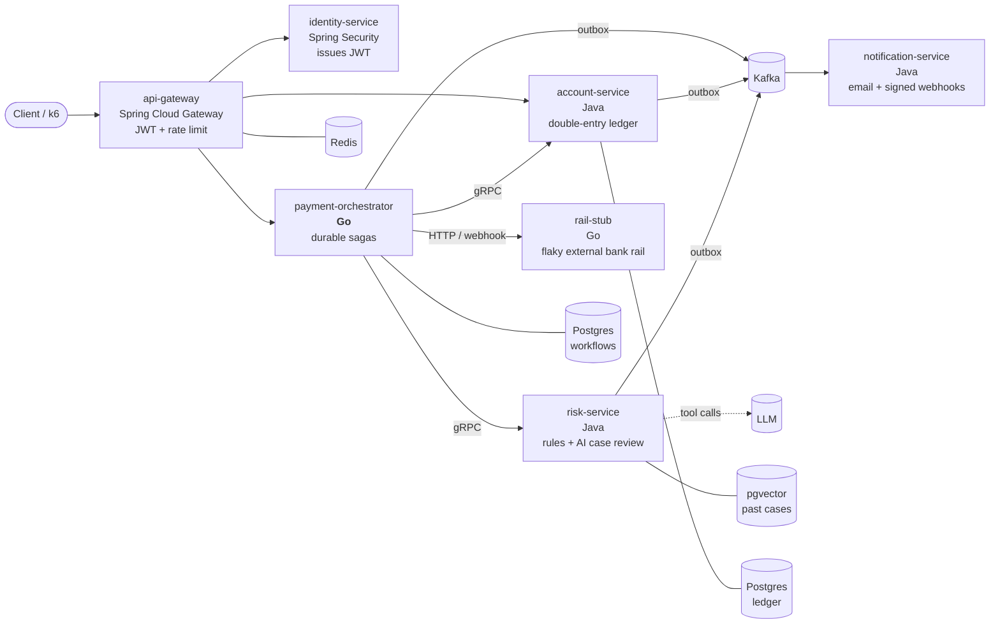
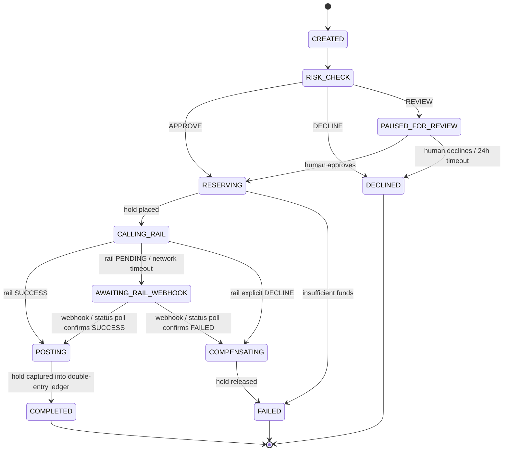

# Settle: Crash-Proof Payments Platform

A multi-service payments platform where money is never created, lost or charged twice, even while services are being killed.

- **Java 21 + Spring Boot** for the domain services (ledger, risk, notifications, identity, gateway)
- **Go** for the saga orchestrator (the durable workflow engine at the heart of every transfer)
- **AI** for fraud case review: an agent prepares the case, a human decides, and the paused transfer resumes

The headline claim, proven with a chaos test and an invariant checker:

> Across [N] transfers with random service kills, network faults, and flaky external bank timeouts: **0 money created, 0 money lost, 0 double charges** — with **[F] zombie writes blocked by fencing tokens**, **[D] duplicate retries deduplicated**, and **[L] crashed sagas recovered via lease expiry**.

---

## 0. Ground rules

- **No UIDAI code, data, names or internal details.** Settle is inspired by patterns you've worked with (pause-resume, Kafka retries, fail-open checks) but everything is written from scratch for a payments domain.
- **You must be able to rebuild every feature alone.** We build it together: you write or walk through each piece, and I explain, review and fill gaps. Each phase ends with you explaining its design out loud, the way you would in an interview.
- **No secrets in git.** `.env` files are gitignored, `.env.example` documents them, and gitleaks runs as a pre-commit hook and in CI.
- **Measured numbers only** on the resume and README.

## Scope and non-goals

| In scope | Out of scope (say so in the README) |
|---|---|
| Internal transfers **plus payouts via a simulated flaky external bank rail (`rail-stub`)** in one currency (INR) | Real live bank or UPI NPCI integration, card networks |
| Holds, external rail settlement (`SUCCESS` / `FAILED` / `PENDING` + async webhook), double-entry posting, reversal of failed transfers | Multi-currency, FX, interest, fees |
| Rules-based risk + AI-assisted human review | Training ML fraud models |
| One region, Postgres per service | Multi-region replication, sharding |

---

## 1. Why this project

| Goal | How Settle covers it |
|---|---|
| Public proof of Java + Spring Boot | Core domain services (`account-service`, `risk-service`) built first for MVP; optional peripheral services (`notification-service`, `identity-service`, `api-gateway`) added after chaos proof |
| Public proof of Go | The orchestrator (`payment-orchestrator` + `rail-stub`): concurrency, leases, gRPC, Kafka, written from scratch |
| Distributed systems depth | Sagas across a real remote boundary (ledger hold + flaky external rail), outbox, idempotency, leases with fencing, handling unknown timeout states |
| MNC job-post keywords | Microservices, Kafka, gRPC, PostgreSQL, Redis, Docker, Kubernetes, AWS, CI/CD, observability |
| AI, used responsibly | Human-in-the-loop fraud case review with tool calling and vector search, never in the money path |
| A story from your real job | It's the general version of the Pause-Resume work you did for Aadhaar updates |

---

## 2. Architecture

> **Core-First Strategy:** Build and chaos-test the **3 core services** (`payment-orchestrator`, `account-service`, `risk-service` + `rail-stub`) first to reach the MVP and Chaos Proof early. Peripheral plumbing (`notification-service`, `api-gateway`, `identity-service`) is layered on only after the core distributed system is proven.



Each service owns its own database schema. Services never read each other's tables.

| Service | Tier | Language | Owns | Talks via |
|---|---|---|---|---|
| `account-service` | **Core (MVP)** | Java, Spring Boot | Accounts, holds, double-entry ledger, balances, settlement clearing account | gRPC (internal), HTTP (queries) |
| `payment-orchestrator` | **Core (MVP)** | **Go** | Transfer sagas: state, steps, retries, timers, fencing, compensation | HTTP (public + rail webhooks), gRPC client, Kafka |
| `risk-service` | **Core (MVP)** | Java, Spring Boot + Spring AI | Fraud rules, velocity (Redis), review cases, AI case summaries | gRPC, HTTP (review console), Kafka |
| `rail-stub` | **Core (MVP)** | **Go** (lightweight simulator) | Simulates an external bank/UPI rail that randomly drops connections, returns `PENDING`, and settles via delayed HMAC webhook | HTTP |
| `notification-service` | Post-MVP | Java, Spring Boot | Emails, HMAC-signed webhooks with retries | Kafka consumer |
| `api-gateway` | Post-MVP | Java, Spring Cloud Gateway | Routing, JWT verification, rate limiting (Redis) | HTTP |
| `identity-service` | Post-MVP (Optional) | Java, Spring Security | Users, login, JWT issuing (RS256 + JWKS endpoint) | HTTP |

Shared contracts live in `proto/` (Protocol Buffers, managed with `buf`), so Java and Go generate clients from the same source.

---

## 3. The life of a transfer (Why a Saga is required)

If both source and destination lived in the same Postgres database with no external calls, a single SQL transaction could move the money and a distributed saga wouldn't be needed. Settle requires a saga because transfers cross service and network boundaries (Risk check + Ledger hold + External Bank Rail payout that can time out or stay `PENDING`):



1. **Create.** The client calls `POST /transfers` with an `Idempotency-Key` header. A repeated key returns the original result instead of creating a second transfer.
2. **Risk check.** Rules return APPROVE, DECLINE or REVIEW. REVIEW pauses the saga durably (see section 6).
3. **Reserve.** `account-service` places a hold on the source account (`available_minor` decreases, `held_minor` increases). Compensation: release the hold.
4. **External Rail Call (for external payouts) or Internal Clear.** The orchestrator calls `rail-stub` with `{transferId}:rail`.
   - If `rail-stub` returns `SUCCESS`, move to **Post**.
   - If `rail-stub` returns `PENDING` or **times out** (ambiguous state: did the bank move the money or not?), the orchestrator **never blindly retries or releases the hold**. It moves to `AWAITING_RAIL_WEBHOOK`, waits for the signed webhook (or polls status after a timer), and only then posts or compensates.
5. **Post (Capture).** `account-service` atomically captures the hold into an immutable double-entry transaction (debit source account, credit destination or settlement clearing account).
6. **Notify.** The orchestrator writes `transfer.completed` to its outbox; a relay publishes it to Kafka.

Every call from the orchestrator carries the idempotency key `{transferId}:{step}`. The key stays the same across retries, so a retried step can never apply twice.

---

## 4. account-service: the ledger (Java)

**Rules that must always hold:**
- Money is stored as `long` minor units (paise). Never `double`.
- Ledger entries are append-only. Corrections are new entries, never updates.
- Every transaction has entries that sum to zero (total debits = total credits).
- An account's balance always equals the sum of its entries.

**Tables (sketch)**

| Table | Key columns |
|---|---|
| `accounts` | `id`, `owner_id`, `currency`, `status`, `version` |
| `ledger_transactions` | `id`, `idempotency_key` (unique), `type`, `created_at` |
| `ledger_entries` | `id`, `transaction_id`, `account_id`, `direction` (DEBIT/CREDIT), `amount_minor` |
| `balances` | `account_id`, `available_minor`, `held_minor`, `version` |
| `holds` | `id`, `account_id`, `amount_minor`, `status`, `expires_at`, `idempotency_key` |
| `idempotency_records` | `key`, `request_hash`, `response`, `status`, `created_at` |
| `outbox` | `id`, `aggregate_id`, `type`, `payload`, `created_at`, `published_at` |

**What you'll learn here:** `@Transactional` propagation and isolation levels, optimistic locking (`@Version`) vs `SELECT … FOR UPDATE`, deadlock avoidance (always lock accounts in ID order), JPA N+1 queries, Flyway migrations, Testcontainers.

---

## 5. payment-orchestrator: the durable saga engine (Go)

This is the most important service. It's a small version of Temporal, built for one workflow type.

**Tables (sketch)**

| Table | Purpose |
|---|---|
| `workflows` | `id`, `type`, `state`, `current_step`, `next_run_at`, `attempts`, `lease_owner`, `lease_until`, `fence` |
| `workflow_events` | Append-only history: every step started, succeeded, failed, compensated, signalled |
| `timers` | Durable timers (e.g. "auto-decline at T+24h") |
| `signals` | External inputs (e.g. human review decision) waiting to be applied |
| `outbox` | Events to publish to Kafka |

**How it works**
- **Workers claim work** with `SELECT … WHERE next_run_at <= now() FOR UPDATE SKIP LOCKED LIMIT n`, then set a lease (`lease_owner`, `lease_until`).
- **Leases are renewed** by heartbeat. If a worker dies, its lease expires and another worker picks the workflow up.
- **Fencing tokens** stop "zombie" workers: every lease increments `fence`, and every write checks it. A worker that paused for a long GC and woke up late can't overwrite newer progress.
- **Retries** with exponential backoff and jitter; a step that keeps failing moves the saga to COMPENSATING.
- **Compensation** runs completed steps' undo actions in reverse order.
- **Durable timers and signals** let a saga wait for hours (human review) without holding a goroutine or a thread.
- **Outbox relay** publishes events to Kafka after the database commit, so a crash can't lose or invent an event.

**Go libraries:** `pgx` (Postgres), `grpc-go`, `franz-go` (Kafka), `chi` (HTTP), OpenTelemetry Go SDK, `testcontainers-go`.

**What you'll learn here:** goroutines, channels, `context` cancellation, worker pools, graceful shutdown, leases and fencing, at-least-once vs exactly-once, why "exactly-once delivery" is really "at-least-once delivery + idempotent effects".

---

## 6. risk-service: rules + AI case review (Java)

**Real-time path: rules only.** Fast, deterministic, explainable. No LLM here.
- Amount limits per account tier
- Velocity: too many transfers or too much money in a time window (counters in Redis)
- New-beneficiary checks: first transfer to a new account above a threshold
- Returns APPROVE, DECLINE or REVIEW, with the rules that fired

**Review path: AI assists, a human decides.**
1. A REVIEW decision creates a review case and publishes `risk.case.opened`.
2. The **case review agent** (Spring AI, tool calling) investigates with tools:
   - `getAccountHistory(accountId, days)`
   - `getVelocityStats(accountId)`
   - `getBeneficiaryHistory(source, destination)`
   - `findSimilarCases(caseId)`: vector search over past cases in **pgvector**
3. The agent writes a structured summary: signals found, similar past cases and their outcomes, a recommendation (APPROVE/DECLINE) with confidence, and the evidence for it.
4. A human reviewer approves or declines in a small review console (React). That decision is sent to the orchestrator as a **signal**, and the paused saga resumes.
5. If nobody decides within 24 hours, a durable timer declines the transfer automatically.

**Guardrails**
- The AI never moves money and never makes the final decision.
- Outputs are schema-validated JSON; invalid output falls back to "no AI summary" and the case still works.
- Every recommendation is stored next to the human's decision, so agreement can be tracked in production.
- **Offline eval:** a labelled set of synthetic fraud and legitimate scenarios measures recommendation accuracy and evidence correctness. Live human decisions aren't used for scoring, because during development the only reviewer is you, so they aren't independent. See [../reviewbench/EVAL_ROADMAP.md](../reviewbench/EVAL_ROADMAP.md).
- Prompt-injection hygiene: free-text fields like transfer notes are treated as data, never as instructions.

**What you'll learn here:** Spring AI, tool calling, structured outputs, embeddings and vector search, human-in-the-loop design, measuring an AI feature.

---

## 7. notification-service (Java)

- Consumes `transfer.completed`, `transfer.failed`, `risk.case.opened` from Kafka
- **Idempotent consumer:** stores processed event IDs, so redelivered events don't send twice
- Retries with backoff, then a **dead-letter topic**
- Webhooks signed with HMAC-SHA256 so receivers can verify them
- Local email testing with Mailpit

---

## 8. identity-service + api-gateway (Java)

- identity-service: user registration and login, BCrypt passwords, issues RS256-signed JWTs, publishes a JWKS endpoint
- api-gateway: Spring Cloud Gateway as an OAuth2 resource server, verifies JWTs via JWKS, rate limits per user with Redis, adds a correlation ID to every request
- Role-based access: `USER` can create transfers, `REVIEWER` can decide review cases

---

## 9. Proof: observability, load, chaos, and defense metrics

**Observability**
- OpenTelemetry tracing across Java and Go: one trace shows a transfer from the gateway through the orchestrator to the ledger and Kafka
- Micrometer and Go metrics to Prometheus; Grafana dashboards for transfers/sec, p50/p99 latency, saga states, retry counts, Kafka consumer lag, dead-letter count
- Structured JSON logs with trace IDs

**Defense Metrics (proving the safety nets actually fired)**
Saying "0 money lost" is good; proving how many disasters were actively prevented during chaos is even stronger. The services expose explicit counters for:
- `settle_fencing_conflicts_blocked_total`: stale "zombie" worker writes rejected because their fencing token was outdated
- `settle_idempotency_duplicates_caught_total`: duplicate client or orchestrator step retries deduplicated without re-executing
- `settle_expired_leases_recovered_total`: in-flight sagas taken over by a healthy worker after another worker was killed (`kill -9`)
- `settle_rail_ambiguous_timeouts_resolved_total`: external bank timeouts (`UNKNOWN`/`PENDING`) safely resolved via webhook or reconciliation without double-charging

**Load test (k6)**
- Ramp to a target rate of transfers; record throughput and p50/p95/p99 latency
- Publish the numbers and the hardware they were measured on

**Chaos test**
- A script kills or pauses (`SIGSTOP` / `SIGCONT` to trigger zombie workers) a random service container every few seconds during the load test
- `rail-stub` injects 10% timeouts, 15% `PENDING` async settlements, and duplicate webhooks
- Toxiproxy adds latency, drops connections and cuts the network between the orchestrator and account-service
- Kafka broker restarts mid-run

**Invariant checker (runs after every chaos run, starting right from MVP)**
1. Sum of all ledger entries = 0 (no money created or destroyed)
2. Every account's balance = sum of its entries
3. Every COMPLETED transfer has exactly one ledger posting (and matching external rail settlement if applicable)
4. Every FAILED or DECLINED transfer has zero net ledger effect and no open holds
5. No saga is stuck: every workflow is terminal or has a valid lease or timer
6. Every COMPLETED transfer produced exactly one outbox/notification event
7. Defense counters (`fencing_conflicts_blocked`, `idempotency_duplicates_caught`, `expired_leases_recovered`) are `> 0`, proving faults actually hit the system and were caught

The resume line comes straight from this run's output.

---

## 9b. Operational details (easy to forget, often asked about)

| Topic | Decision |
|---|---|
| **Expired holds** | A scheduled sweeper in account-service releases holds past `expires_at` (only after verifying with the orchestrator/rail that the payout did not settle), and the orchestrator compensates the saga. Without it, money stays stuck. |
| **Reconciliation** | A nightly job recomputes every balance from ledger entries AND cross-checks external `rail-stub` settlement records against `account-service` postings, alerting on any mismatch. |
| **Kafka ordering** | Events are keyed by account ID (or transfer ID), so events for one account stay in order within a partition. |
| **Event schemas** | Every event has a `type`, `version`, `event_id` and `occurred_at`. Payloads are defined in `proto/` and only changed in backward-compatible ways. |
| **Outbox cleanup** | Published outbox rows are deleted after a retention period. |
| **Workflow versioning** | Every saga records the workflow version it started with, so code changes don't break transfers already in flight. |
| **Migrations** | Flyway for Java services, `golang-migrate` for the orchestrator. Migrations run before the app starts. |
| **API docs** | OpenAPI (springdoc) for Java REST APIs; the orchestrator's HTTP API documented in an OpenAPI file. |
| **Health and shutdown** | Liveness and readiness endpoints on every service; graceful shutdown finishes in-flight work and releases leases. |
| **Seed data** | A script creates demo users and accounts with balances, so the demo and load tests start from a known state. |
| **Cost control** | LLM calls only on REVIEW cases, with a monthly cap. AWS budget alert set before deploying; environment torn down after recording. |

---

## 10. Testing strategy

| Level | Tools |
|---|---|
| Unit | JUnit 5 + AssertJ (Java), Go `testing` |
| Integration | Testcontainers (Postgres, Kafka, Redis) in both Java and Go |
| Contract | Shared `.proto` files; `buf breaking` in CI catches incompatible changes |
| Concurrency | Many parallel duplicate requests with the same idempotency key must produce one effect |
| End-to-end | docker compose + scripted transfers |
| Load / chaos | k6, Toxiproxy, kill/pause script, `rail-stub` fault injection, invariant checker |

---

## 11. Infrastructure

- **Local:** one `docker compose up` starts everything (services, Postgres, Kafka in KRaft mode, Redis, Mailpit, Prometheus, Grafana, Jaeger/Tempo, Toxiproxy)
- **Kubernetes:** Helm chart, tested locally on `kind`
- **Cloud:** a single AWS EC2 instance running k3s keeps cost low (EKS works too but costs more per month). Tear it down after recording the demo.
- **CI (GitHub Actions):** build and test each service, `buf lint` + `buf breaking`, build images, push to GitHub Container Registry
- **Code review:** ArchFox reviews every pull request in this repo

---

## 12. Repo layout

```
settle/
├── proto/                    # .proto contracts + buf config
├── services/
│   ├── account-service/      # [Core MVP] Java, Spring Boot
│   ├── payment-orchestrator/ # [Core MVP] Go (includes rail-stub simulator)
│   ├── risk-service/         # [Core MVP] Java, Spring Boot + Spring AI
│   ├── notification-service/ # [Post-MVP] Java, Spring Boot
│   ├── api-gateway/          # [Post-MVP] Java, Spring Cloud Gateway
│   └── identity-service/     # [Optional] Java, Spring Security
├── review-console/           # React (small)
├── deploy/
│   ├── docker-compose.yml
│   └── helm/
├── tests/
│   ├── load/                 # k6 scripts
│   ├── chaos/                # kill/SIGSTOP script, Toxiproxy scenarios
│   └── invariants/           # invariant + defense-counter checker
├── docs/                     # architecture, decisions (ADRs), results
└── .github/workflows/
```

Java services use Maven (most common in MNC codebases). Java 21 with virtual threads enabled.

---

## 13. Milestones (Core-First Order)

Each phase ends with something that runs. **The Core MVP (end of Phase 3) already includes the Chaos Test and Invariant Checker across the 3 core services**—so you get the highest-value resume proof first without burning out on peripheral plumbing.

| Phase | Weeks | Deliverable | Main things you'll learn |
|---|---|---|---|
| 0. Foundations | 1 | Repo, compose, proto + buf, CI skeleton | Monorepo setup, Protocol Buffers, GitHub Actions |
| 1. Ledger | 2–3 | `account-service`: accounts, holds, double-entry posting, idempotency, Testcontainers tests | JPA, transactions, locking, idempotency |
| 2. Saga engine + Flaky Rail | 4–6 | Go `payment-orchestrator` + `rail-stub`: durable sagas, worker leases, fencing, retries, compensation, handling `PENDING`/unknown timeouts | Go concurrency, leases, fencing, ambiguous timeout recovery |
| 3. Risk, Pause & Chaos MVP | 7–8 | `risk-service` rules, REVIEW → durable pause/signal/timer, **Invariant Checker + First Chaos Run (`kill -9` + `SIGSTOP` + rail timeouts)** | Durable waits, signals, timers, chaos testing, invariant verification |
| **🏁 CORE MVP** | | **3 core services + flaky rail survive crashes & zombie workers; first chaos & defense metrics recorded** | |
| 4. AI case review | 9–10 | Spring AI agent with tools, pgvector similar cases, review console, agreement tracking | Tool calling, embeddings, human-in-the-loop |
| 5. Events & Notifications | 11 | Outbox relays, Kafka, `notification-service` with dead-letter topic and signed webhooks | Outbox pattern, idempotent consumers |
| 6. Gateway & Security | 12 | `api-gateway` (rate limiting, JWT verification) + optional `identity-service` | Spring Security, OAuth2 resource server, Redis rate limiting |
| 7. Full Proof & Ship | 13–14 | OpenTelemetry tracing, Grafana dashboards, full k6 load + chaos benchmark, Helm/k3s, README & demo video | Observability, performance testing, Kubernetes, technical writing |

At roughly one focused day per weekend plus a few evenings, you reach the **Chaos-Tested Core MVP in 8 weeks**, and the full polished platform in 14 weeks.

---

## 14. Resume lines (fill in measured numbers only)

> **Settle**: crash-proof payments platform in **Java 21 (Spring Boot)** and **Go** over gRPC and Kafka. Built a durable saga orchestrator (worker leases, fencing tokens, compensation, transactional outbox) coordinating a double-entry ledger and a flaky external bank rail. Sustained **[X] transfers/s (p99 [Y] ms)**; chaos-tested across **[N]** transfers with container kills, `SIGSTOP` pauses, and network faults—proving **0 money lost, created, or double-charged** while blocking **[F] zombie writes** and deduplicating **[D] retries**.

> Built a human-in-the-loop **AI fraud case reviewer** (Spring AI, tool calling, pgvector): suspicious transfers durably pause and resume on reviewer signals, achieving **[Z]%** recommendation accuracy on labelled fraud scenarios.

---

## 15. Interview topics this project prepares you for

- Design a payment system / wallet / ledger
- How do you prevent double charges? (idempotency keys, unique constraints, idempotent consumers)
- Dual-write problem and the transactional outbox
- Saga vs two-phase commit; orchestration vs choreography
- Exactly-once semantics in Kafka, and why idempotent effects matter more
- Distributed locks, leases and fencing tokens
- Optimistic vs pessimistic locking; isolation levels; deadlocks
- `@Transactional` internals (proxies, propagation, self-invocation pitfall)
- Circuit breakers, retries with jitter, timeouts, bulkheads
- Rate limiting algorithms (token bucket in Redis)
- JWT vs sessions, RS256 vs HS256, JWKS rotation
- Go concurrency: goroutines, channels, context, worker pools, graceful shutdown
- Observability: traces vs metrics vs logs, p99 vs average
- Where AI belongs in a critical system, and how to measure it
