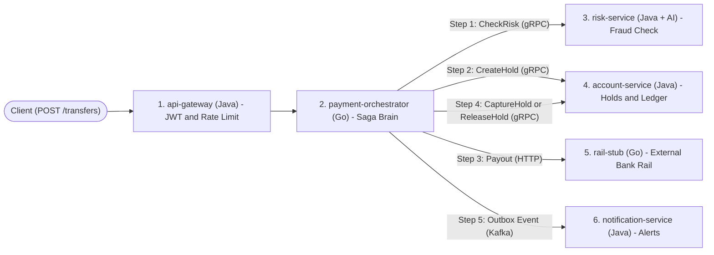
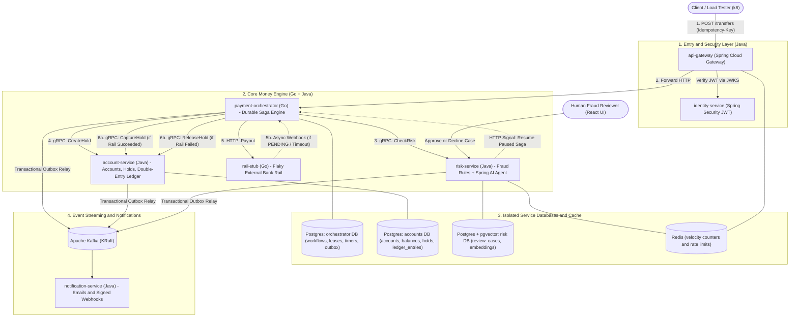
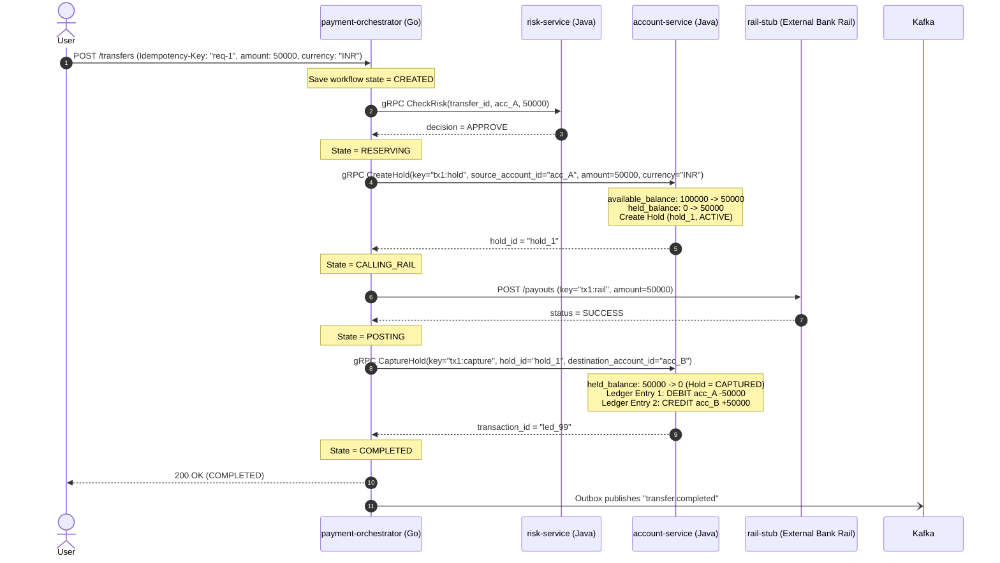
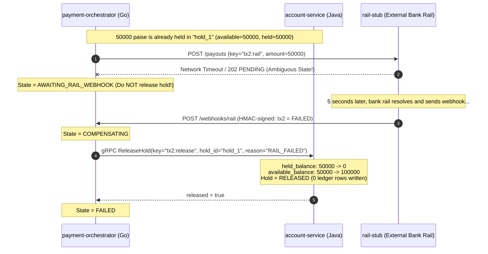
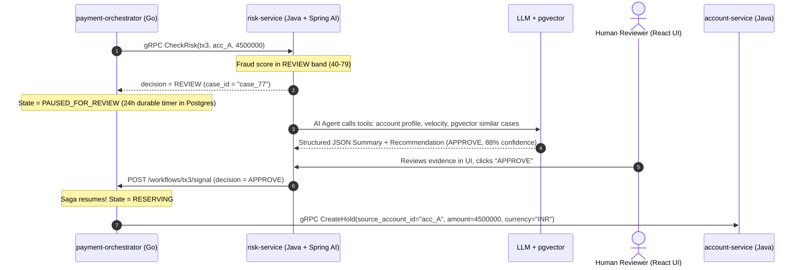

# Settle: Complete System Architecture & Guide

---

## 1. Enterprise Naming Glossary (Why Every Term Is Named This Way)

Settle uses the exact terminology you will see in production codebases at **Stripe, Razorpay, Adyen, and Modern Treasury**:

| Enterprise Term Used in Code | Plain-English Meaning | Why Enterprise Systems Use This Exact Name |
|---|---|---|
| **`CreateHold`** | Freeze ₹500 on the sender's account before calling the outside bank. | Every RPC follows `Verb + ResourceNoun`. Creates a `Hold` row (`status = ACTIVE`) and returns `hold_id`. |
| **`CaptureHold`** | Outside bank succeeded! Permanently move the frozen ₹500 into the accounting ledger. | Universal payments term (Stripe/Razorpay/Visa): "Capturing" a hold turns a temporary freeze into a final ledger debit & credit. |
| **`ReleaseHold`** | Outside bank failed! Unfreeze the ₹500 and return it to `available_balance`. | Releases an uncaptured `Hold`. *(In payments, "Refund" is reserved for returning money days after a completed purchase, whereas "Release/Void" cancels an in-flight hold).* |
| **`amount` + `currency`** | `amount = 50000`, `currency = "INR"` (₹500.00 in paise). | Stripe/Razorpay standard: never hardcode `_paise` or `_cents` in field names so the schema supports any ISO-4217 currency in minor units using `int64`. |
| **`source_account_id` / `destination_account_id`** | Sender's account ID and receiver's account ID. | Unambiguous industry-standard pairing across Stripe and Modern Treasury APIs. |
| **`available_balance` / `held_balance`** | Spendable money vs frozen in-flight money. | Standard core banking ledger columns. |
| **`rail-stub`** | Simulator for an external banking network (UPI / IMPS / ACH). | In fintech, external payment networks are called **"Payment Rails"**. |

---

## 2. What is "Settle" and Why the Name?

### The Real-World Problem
Have you ever paid ₹500 on an app, the screen spun for 10 seconds and said *"Payment Failed"*, and then you got an SMS saying **"₹500 debited from your account"**—even though the merchant never received it? Or you tapped "Pay" twice on slow Wi-Fi and got **charged ₹500 twice**?

Why does that happen? Because moving money is **never a single database update**. When you tap "Pay ₹500", the backend has to coordinate across **4 separate systems** over the network:
1. Check if the payment looks like fraud (`risk-service`).
2. Place a hold on ₹500 in your account (`account-service` -> `CreateHold`).
3. Call an external bank rail over the internet to deliver the ₹500 (`rail-stub`).
4. Capture the hold into the double-entry ledger (`CaptureHold`) or release the hold (`ReleaseHold`), and publish a notification event (`notification-service`).

If a server crashes between Step 2 and Step 3, or the network drops right after Step 3, a poorly designed backend loses track of where the money is.

### Why the Name **"Settle"**?
In banking and payments, **"Settlement"** (to **settle** a payment) means bringing an in-flight transaction to a **100% final, indisputable state**:
* Either the transfer **completes** (`CaptureHold`) and every ledger entry sums to zero,
* Or, if *anything* fails, the hold is **safely released** (`ReleaseHold`) so not a single paisa is ever stuck, lost, or double-charged.

---

## 3. Why Do We Use BOTH Go and Java?

We split **Go** and **Java** the exact same way real fintech companies (Uber, Razorpay, Grab) do:

| Language | Services | Engineering Reason | Interview & Career Value |
|---|---|---|---|
| **Go (Golang)** | **`payment-orchestrator`** (Durable Saga Engine) & **`rail-stub`** (External Payment Rail Simulator) | **High-Concurrency Workflow Infrastructure:** The orchestrator is a lightweight version of **Temporal** (also written in Go). It polls work queues, renews worker lease heartbeats every 2 seconds, enforces fencing tokens, and coordinates network timeouts. Go's goroutines, channels, and `context` cancellation are purpose-built for distributed engines. | Proves production Go concurrency (worker pools, leases, fencing tokens, gRPC clients, graceful shutdown) built from scratch. |
| **Java 21 + Spring Boot** | **`account-service`** (Ledger), **`risk-service`** (Fraud + AI), **`notification-service`**, **`api-gateway`**, **`identity-service`** | **Financial Domain, ACID Transactions & Enterprise Security:** Banks and fintechs build their core accounting ledgers and domain services in Java + Spring Boot for battle-tested transaction management (`@Transactional`, JPA/Hibernate locking, Flyway), security (`Spring Security`, OAuth2/JWT), gateway routing (`Spring Cloud Gateway`), and AI agents (`Spring AI`). | Covers core MNC Java backend interview topics (`@Transactional` internals, pessimistic/optimistic locking, deadlocks, Spring Security, Spring AI, Kafka). |

---

## 4. Simple Mental Model (The 6-Service Payment Pipeline)

First, look at how a ₹500 transfer flows across the services without database clutter:

---

## 5. Complete Technical Architecture (Services, Isolated Databases, Redis, Kafka & AI)

Every service owns its own database schema (**Database-per-Service**). Services never read each other's tables directly:

---

## 6. End-to-End Sequence Flows (All 3 Scenarios)

### Scenario A: The Happy Path (Instant Approval & Rail Success)

Sayantan (`acc_A`, balance ₹1,000) sends **₹500** (`amount = 50000`, `currency = "INR"`) to `acc_B`.

---

### Scenario B: External Bank Rail Times Out (`PENDING` -> Async Webhook -> `ReleaseHold`)

When an HTTP call to an external bank rail times out, **you do not know if the bank processed the payout or not**.
* **Golden Rule:** Never release the hold on an ambiguous timeout! Park the workflow in `AWAITING_RAIL_WEBHOOK` and keep the funds held until the rail confirms `SUCCESS` or `FAILED`.

---

### Scenario C: Suspicious Transfer — Durable Pause, AI Review & Human Resume

---

## 7. Reference: Two-Phase Holds & Protobuf Fields in [account.proto](../proto/settle/account/v1/account.proto)

### How `CreateHold` -> `CaptureHold` / `ReleaseHold` Affects Balances

For an account starting with **₹1,000** (`100000` paise):

| Account State | 1. Initial | 2. After `CreateHold` | 3a. After `CaptureHold` (Success) | 3b. After `ReleaseHold` (Failed/Void) |
|---|---|---|---|---|
| **`available_balance`** | `100000` (₹1,000) | `50000` (₹500) | `50000` (₹500) | `100000` (₹1,000) |
| **`held_balance`** | `0` (₹0) | `50000` (₹500) | `0` (₹0) | `0` (₹0) |
| **Hold Status** | — | `ACTIVE` | `CAPTURED` | `RELEASED` |
| **Ledger Entries** | None | None | `DEBIT acc_A -50000` `CREDIT acc_B +50000` | None |

### Field-by-Field Reference ([proto/settle/account/v1/account.proto](../proto/settle/account/v1/account.proto))

* **`idempotency_key`** (`"{transfer_id}:hold"`, `"{transfer_id}:capture"`, `"{transfer_id}:release"`):
  Unique key per saga step. If a network timeout causes the orchestrator to retry a step, `account-service` recognizes the `idempotency_key` and returns the cached response without applying the balance change twice.
* **`transfer_id`**:
  Correlates the hold in `account-service` with the saga workflow ID in `payment-orchestrator`.
* **`source_account_id`** & **`destination_account_id`**:
  The sender account (`CreateHoldRequest`) and receiver/clearing account (`CaptureHoldRequest`).
* **`amount`** & **`currency`**:
  `amount` is an `int64` in the smallest unit of `currency` (paise for `"INR"`), preventing floating-point rounding bugs while staying currency-agnostic.
* **`hold_id`**:
  Primary key of the `Hold` created by `CreateHold`, passed into `CaptureHold` or `ReleaseHold` to finalize or void that specific reservation.
