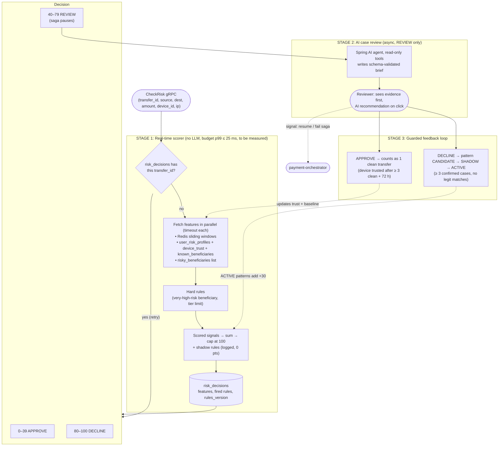

# Settle Fraud Engine (v2): Rules Scorer + AI Case Review + Guarded Feedback Loop

`risk-service` decides APPROVE, REVIEW or DECLINE for every transfer. It is a **rules-based scorer inspired by Stripe Radar's design** (real-time score, explainable reasons, a review queue), not a copy of Radar: Radar is a machine-learning model over 1,000+ signals that learns from card disputes. Ours is a weighted rules engine that a learner can build, explain and test in a week.

---

## 0. What changed from v1 and why

| v1 | Problem | v2 |
|---|---|---|
| pgvector **cosine** match (> 0.92) on 6 raw features, +55 pts in real time | Cosine ignores scale, so the amount ratio dominates. A student paying tuition from their own phone scored **0.99998** against a confirmed account-takeover vector, then 35 + 55 = 90 → DECLINE | Features normalised, **L2 distance**, match adds +30 and **can never decline on its own**; patterns go live only after shadow mode (section 5) |
| One human DECLINE → pattern blocks everyone similar immediately | One wrong click blocks a whole class of users | Pattern lifecycle: CANDIDATE → SHADOW → ACTIVE → EXPIRED, needs ≥ 3 confirmed cases |
| One human APPROVE → device trusted + average raised | A fraudster who passes review once gets a trusted phone and a higher limit for the next drain | Device trust needs ≥ 3 clean transfers **and** 72 h; baseline uses median / p90 |
| Redis keys with TTL (`INCR` + `EXPIRE`, Sets) | Fixed windows allow 2x bursts at the boundary; a Set refreshed on every add never expires | Sorted-set **sliding windows** in one atomic Lua script |
| Counters updated on every `CheckRisk` call | Orchestrator retries the same step, so retries inflate velocity and a replay can return a different decision | **Decision record per `transfer_id`**: a retry returns the stored decision; `ZADD` with `transfer_id` as member is idempotent |
| ₹1 handshake from a trusted device: −10 pts | Most money lost in India goes to scams where the **victim pays from their own phone**, and scammers ask for ₹1 tests too | Handshake is **neutral** (0 pts). Weight moves to **receiver-side** mule signals |
| `user_avg_amount` (mean) | No history → divide by zero; one ₹2 L rent payment inflates the mean for months | Median / p90 of the last 50 transfers; tier defaults until 5 completed transfers |
| "0–100" score | Rule points add up to 255 | Score is **capped at 100** |
| "< 25 ms", "< 3 ms", "< 15 ms" | Not measured yet (SPEC: measured numbers only) | Written as a **latency budget**, measured in Phase 7 |
| AI–human agreement reported as accuracy | Only one reviewer (you) who sees the AI's answer first: anchored and not independent | Accuracy comes from the labelled synthetic set; agreement is tracked internally only |

---

## 1. Design principles

1. **No LLM in the money path.** Real-time decisions use deterministic rules only. The AI works asynchronously on paused cases.
2. **Same transfer, same decision.** `CheckRisk` is idempotent on `transfer_id`, like every other saga step.
3. **Every decision is explainable and replayable.** Each one stores its input features, fired rules and rules version.
4. **Learning never acts directly.** Feedback proposes changes; they run in shadow mode before they can affect a customer.
5. **Score the receiver, not just the sender.** Scams use the victim's real phone; the mule account on the other side is what looks wrong.
6. **Degrade, don't crash.** If Redis or a lookup times out, score with what's available and record that the decision was degraded.

---

## 2. Architecture



---

## 3. Stage 1: the real-time scorer

### 3.1 Request flow (retry-safe) ✍️

```
CheckRisk(req):
  1. row = SELECT * FROM risk_decisions WHERE transfer_id = req.transfer_id
     if row exists → return row's decision                      // orchestrator retry: same answer
  2. features = fetch in parallel (virtual threads), 10 ms timeout each
     a timed-out source → its signals are skipped, degraded = true
  3. decision = hardRules(features) ?: scoreSignals(features)
     if degraded and amount ≥ ₹50,000 and decision == APPROVE → REVIEW   // fail safe on big amounts only
  4. INSERT INTO risk_decisions ... ON CONFLICT (transfer_id) DO NOTHING
     if 0 rows inserted → a concurrent retry won the race: re-read and return its decision
  5. if REVIEW → INSERT review_cases (same DB transaction as step 4)
```

The same idea as idempotency in `account-service`: the unique key is the last line of defence, and the loser of a race returns the winner's result.

### 3.2 Redis sliding windows ✍️

Every window is a **sorted set** with the event time (ms) as score. One Lua script per key does prune → count → add atomically:

```
ZREMRANGEBYSCORE key 0 (now - window)   -- drop old events
ZADD key now member                     -- same member again = no new entry (retry-safe)
ZCARD key                               -- count in the window
PEXPIRE key window                      -- whole key disappears when idle
```

| Key | Window | Member | Feature |
|---|---|---|---|
| `risk:src:tx:{source}` | 60 s | `transfer_id` | `tx_count_60s` |
| `risk:src:targets:{source}` | 60 s | `dest_id` | `unique_targets_60s` |
| `risk:dev:accounts:{device_hash}` | 10 min | `source_id` | `accounts_on_device_10m` |
| `risk:dst:senders:{dest}` | 5 min | `source_id` | `senders_to_dest_5m` (fan-in) |
| `risk:acct:inflow:{account}` | 30 min | `transfer_id:amount` | `inflow_30m` sum and distinct senders (pass-through) |

Notes:
- Attempts are counted **including declined ones**: an attacker retrying after a decline should look faster, not slower.
- `inflow` is recorded on APPROVE for the MVP. From Phase 5 it should come from `transfer.completed` events on Kafka, so only money that actually arrived counts.
- `device_id` and `ip` are stored **hashed** (SHA-256 with a server-side salt), never in plain text.

### 3.3 Sender baseline (fixes the ₹50k problem without the mean)

`user_risk_profiles` keeps the last 50 completed amounts. From them:

- `baseline = max(p90(recent_amounts), tier_floor)` (tier floor e.g. ₹5,000)
- `spike = amount / baseline`
- **Cold start:** fewer than 5 completed transfers → `baseline = tier_default` and the `NEW_ACCOUNT` signal may fire.

Why p90 and not the mean: a business owner who usually pays ₹60k–₹90k has p90 ≈ ₹85k, so ₹1 L is a 1.2x spike (0 pts). One unusual ₹2 L transfer barely moves p90 but would drag a mean up for months.

### 3.4 Hard rules (decide immediately, no scoring)

| Rule | Condition | Decision |
|---|---|---|
| `BENEFICIARY_VERY_HIGH_RISK` | `dest` is on `risky_beneficiaries` with tier `VERY_HIGH` | DECLINE |
| `TIER_LIMIT_EXCEEDED` | amount above the account tier's maximum (SPEC: amount limits per tier) | DECLINE |

`risky_beneficiaries` is a seeded table modelled on India's DoT **Financial Fraud Risk Indicator**, which grades mobile numbers MEDIUM / HIGH / VERY_HIGH. PhonePe reportedly warns and blocks payments to VERY_HIGH numbers.

### 3.5 Scored signals ✍️

Weights are **starting hypotheses**: they live in config with a `rules_version`, and get tuned against the labelled scenarios, not by intuition.

| Signal | Fires when | Pts | Side |
|---|---|---|---|
| `AMOUNT_SPIKE` | `spike ≥ 10` **and** amount ≥ ₹10,000 | +35 | sender |
| `NEW_DEVICE_NEW_BENEFICIARY` | device not trusted **and** never paid this beneficiary | +30 | sender |
| `RAPID_BURST` | `tx_count_60s ≥ 5` | +40 | sender |
| `MULTI_TARGET_PROBING` | `unique_targets_60s ≥ 3` | +25 | sender |
| `SHARED_DEVICE_RING` | `accounts_on_device_10m ≥ 3` | +50 | network |
| `MULE_FAN_IN` | `senders_to_dest_5m ≥ 4` | +45 | receiver |
| `MULE_PASS_THROUGH` | sender received ≥ 80% of this amount in the last 30 min from ≥ 2 senders **and** first seen < 30 days ago | +45 | receiver (cash-out) |
| `BENEFICIARY_HIGH_RISK` | `dest` on the list with tier `HIGH` | +40 | receiver |
| `NEW_ACCOUNT` | sender first seen < 7 days ago **and** amount ≥ ₹10,000 | +20 | sender |
| `KNOWN_PATTERN_MATCH` | matches an **ACTIVE** pattern (section 5.3) | +30 | learned |
| ₹1 handshake | ₹1–₹5 to the same beneficiary shortly before | **0** | — |

**Score** = min(100, sum of points). 0–39 APPROVE, 40–79 REVIEW, 80–100 DECLINE.

**Why the ₹1 handshake is neutral:** we shouldn't punish it (most people in India do it), and we shouldn't reward it either: in investment and "digital arrest" scams the victim does the handshake themselves, from their own phone, because the scammer asks them to. Bot probing across many accounts is already caught by `MULTI_TARGET_PROBING` and `RAPID_BURST`.

**Shadow rules:** a rule with `mode: SHADOW` is evaluated and written to `risk_decisions.shadow_fired` but adds 0 pts. New rules always start in shadow mode.

### 3.6 Worked examples (use these as test cases)

| # | Scenario | Signals | Score | Decision |
|---|---|---|---|---|
| 1 | Business owner sends ₹1 L, p90 ₹85k, own phone, known supplier | none | 0 | APPROVE |
| 2 | Student pays ₹30k tuition, p90 ₹300, own trusted phone | `AMOUNT_SPIKE` | 35 | APPROVE |
| 3 | Same student account, attacker's new phone, ₹30k to a new beneficiary | `AMOUNT_SPIKE` + `NEW_DEVICE_NEW_BENEFICIARY` | 65 | REVIEW |
| 4 | Scam victim does ₹1 handshake, then sends ₹50k (5x, no spike) from own phone to a mule that received from 5 victims in 5 min | `MULE_FAN_IN` | 45 | REVIEW (v1: −10 + 45 = 35 → **APPROVE, money lost**) |
| 5 | Same as 4, mule is also on the list as HIGH | `MULE_FAN_IN` + `BENEFICIARY_HIGH_RISK` | 85 | DECLINE |
| 6 | Bot fires ₹1 to 6 accounts in 60 s from a new device | `RAPID_BURST` + `MULTI_TARGET_PROBING` + `NEW_DEVICE_NEW_BENEFICIARY` | 95 | DECLINE |
| 7 | 5-day-old account receives ₹48k from 3 senders in 20 min, then sends ₹45k out | `MULE_PASS_THROUGH` + `NEW_ACCOUNT` | 65 | REVIEW |
| 8 | Orchestrator retries `CheckRisk` for the same transfer 3 times | (returned from `risk_decisions`) | same | same; `tx_count_60s` unchanged |

### 3.7 Latency budget (targets, measure in Phase 7)

| Step | Budget |
|---|---|
| Decision-cache lookup (PK read) | 2 ms |
| Redis + Postgres + list lookups, **in parallel** | 10 ms (hard timeout each) |
| Rule evaluation | < 1 ms |
| Insert decision record | 3 ms |
| **Total target** | **p99 ≤ 25 ms** |

For comparison, Stripe says Radar decides in under 100 ms. Ours is simpler, so a tighter budget is plausible, but it only goes on the README once k6 measures it.

---

## 4. Stage 2: AI case review (async, REVIEW only)

1. `CheckRisk` returns REVIEW; the orchestrator pauses the saga. A `review_cases` row exists (created in step 5 of 3.1).
2. A background job picks up OPEN cases. The **Spring AI agent** gets **read-only** tools (names from SPEC.md):
   - `getAccountHistory(accountId, days)`: recent transfers and baseline
   - `getVelocityStats(accountId)`: the window counts from the decision record
   - `getBeneficiaryHistory(source, destination)`: past payments between them, receiver fan-in, pass-through, list tier
   - `findSimilarCases(caseId)`: **pgvector** search over embeddings of past case summaries, with their human outcomes. Text embeddings are where vector search actually fits.
3. The agent returns JSON that must pass schema validation:
   ```json
   {
     "recommendation": "APPROVE | DECLINE",
     "confidence": 0.0,
     "evidence": [{ "claim": "…", "source_field": "features.senders_to_dest_5m" }]
   }
   ```
   Every evidence item must cite a field that exists in the decision record or a tool result. Uncited claims are dropped.
4. **Guardrails:** user text (transfer notes) is passed as data, never as instructions; tools are read-only, so the agent cannot move money; 30 s timeout; monthly cost cap. On failure or invalid output: `ai_status = UNAVAILABLE` and the case still works without a summary.
5. **Reviewer UI:** shows fired rules and evidence first. The AI recommendation appears on click, and `ai_revealed_before_decision` is stored, so anchoring can be measured.
6. No decision in 24 h → durable timer auto-declines (SPEC section 6).

---

## 5. Stage 3: guarded feedback loop

### 5.1 Every human decision
- Signals the orchestrator to resume or fail the saga.
- Stores `human_decision`, `decided_at` and the reviewer on the case.

### 5.2 APPROVE (false positive) → slow trust
- The transfer counts as **one clean transfer** for that device. A device becomes trusted only after **≥ 3 clean completed transfers and ≥ 72 h** since first seen, and no fraud report.
- The beneficiary is added to `known_beneficiaries`.
- The amount enters `recent_amounts` like any other completed transfer. p90 moves slowly by design.

### 5.3 DECLINE (confirmed fraud) → pattern lifecycle ✍️

```
CANDIDATE ──(≥ 3 confirmed fraud cases within distance r)──► SHADOW
SHADOW ──(7 days: matches only confirmed fraud, 0 matches on approved transfers)──► ACTIVE (+30 pts)
ACTIVE ──(30 days without a new confirmed match)──► EXPIRED
any state ──(matches a transfer a human approved)──► back to CANDIDATE
```

**Pattern vector** (8 numbers), normalised so that no single feature dominates:

```
raw = [spike, tx_count_60s, unique_targets_60s, is_new_device_new_beneficiary,
       accounts_on_device_10m, senders_to_dest_5m, inflow_ratio_30m, is_new_account]
x_i = (log1p(raw_i) - mean_i) / std_i        // mean/std from feature_stats, refreshed nightly
match = L2 distance (pgvector "<->") ≤ r
```

- `log1p` squashes huge ratios (150x vs 10x matters, 150x vs 160x doesn't).
- Standardising puts counts, ratios and flags on the same scale.
- **L2 distance**, unlike cosine, also sees magnitude: `[2,6,6,…]` and `[20,60,60,…]` are no longer "identical".
- `KNOWN_PATTERN_MATCH` is +30 and **can't decline on its own**. It needs at least one other real signal to reach REVIEW, or two to reach DECLINE.
- **Honest note:** with 8 dimensions and a few hundred patterns, an exact scan is as fast as an index. pgvector is used because the data already lives in Postgres and Stage 2 uses it too, not because this needs HNSW.

**Demo story (replaces v1's "auto-declined 5 seconds later"):** the same attack hits 3 accounts; the reviewer confirms each; the pattern moves to SHADOW and the decision log shows "would have matched" on the next attempts; once ACTIVE, the next attempt scores 65 + 30 = 95 → DECLINE without a human.

### 5.4 Labels and blind spots
- Auto-declined transfers never get a human label, so their false-positive rate can't be measured from live data. Mitigation: sample some declines into an offline review queue.
- Approved transfers can turn out to be fraud later. A small `POST /fraud-reports` endpoint (the simulated "victim calls the 1930 helpline") records these as labels; it's the main false-negative signal.

### 5.5 Metrics
| Metric | Meaning |
|---|---|
| `risk_decisions_total{decision}` | APPROVE / REVIEW / DECLINE rates |
| `risk_review_overturned_ratio` | REVIEW cases a human approved (false-positive proxy) |
| `risk_fraud_reports_on_approved_total` | fraud found after approval (false-negative proxy) |
| `risk_degraded_decisions_total` | decisions made without some features |
| `risk_pattern_shadow_matches_total{outcome}` | how promotable patterns are |
| `risk_ai_agreement_ratio` | internal only, **not** accuracy |

The resume's `[Z]%` comes from the **labelled synthetic scenarios** (`../reviewbench/EVAL_ROADMAP.md`), not from your own review clicks.

---

## 6. Schema for `V1__init_risk.sql` ✍️

| Table | Key columns | Phase |
|---|---|---|
| `risk_decisions` | `transfer_id` **PK**, `source_account_id`, `destination_account_id`, `amount`, `decision`, `score`, `fired_rules` jsonb, `shadow_fired` jsonb, `features` jsonb, `rules_version`, `degraded`, `review_case_id`, `created_at` | 3 |
| `user_risk_profiles` | `account_id` PK, `first_seen_at`, `completed_count`, `recent_amounts` bigint[] (last 50), `p90_amount`, `median_amount`, `updated_at` | 3 |
| `device_trust` | (`account_id`, `device_hash`) PK, `first_seen_at`, `clean_count`, `trusted_at` | 3 |
| `known_beneficiaries` | (`source_account_id`, `destination_account_id`) PK, `first_paid_at` | 3 |
| `risky_beneficiaries` | `account_id` PK, `tier` (MEDIUM/HIGH/VERY_HIGH), `source`, `expires_at` | 3 |
| `review_cases` | `id`, `transfer_id` unique, `status` (OPEN/APPROVED/DECLINED/EXPIRED), `ai_status`, `ai_recommendation`, `ai_confidence`, `ai_brief` jsonb, `ai_revealed_before_decision`, `human_decision`, `decided_by`, `decided_at`, `summary_embedding` vector(N) | 3 (AI columns used in 4) |
| `fraud_patterns` | `id`, `vector` vector(8), `status`, `confirmed_count`, `shadow_matches`, `legit_matches`, `last_confirmed_at`, `created_at` | 4 |
| `feature_stats` | `feature`, `mean`, `std`, `computed_at` | 4 |

`vector(N)`: N is set by the embedding model chosen in Phase 4.

---

## 7. Suggested changes to `proto/settle/risk/v1/risk.proto`

Not applied yet, since the proto is your contract. Nothing consumes it yet, so changing it now is free; after that, `buf breaking` would flag these:

- `decision`: make it an `enum Decision { DECISION_UNSPECIFIED = 0; APPROVE = 1; REVIEW = 2; DECLINE = 3; }` instead of a string.
- Add `string rules_version = 5;` and `bool degraded = 6;` to `CheckRiskResponse`.
- Update the comments: the score is capped at 100, and "< 25 ms" is a target, not a fact. Call it "Radar-inspired rules scorer".

---

## 8. Optional (not in SPEC yet, needs your OK): cooling-off for first payments

A fourth outcome, `COOL_OFF`: the first transfer above a threshold to a never-paid beneficiary waits N hours on a **durable timer**, and the sender can cancel it. India has discussed a 4-hour delay for first transfers above ₹2,000 to a new payee (reported as a proposal, not a confirmed rule). It reuses the Phase 3 timer machinery, and it's a strong defence against scams, where the victim usually realises within hours.

---

## 9. Who writes what

| ✍️ You | 🧰 Agent |
|---|---|
| Retry-safe `CheckRisk` flow (3.1), sliding-window Lua script (3.2), baseline + signals + scoring (3.3–3.5), worked-example tests (3.6), pattern lifecycle (5.3), `V1__init_risk.sql` | gRPC wiring, Redis/Lua plumbing, Spring AI client setup, JSON schema validation, review UI, metrics registration |

---

## 10. Interview soundbites

- **"Why not just block transfers above ₹50,000?"** Absolute limits block good business users and miss small thefts. We score the amount against the user's own p90, and look at the receiver: scams use the victim's real phone, so the mule on the other side is the strongest signal.
- **"What happens when the orchestrator retries a risk check?"** It gets the stored decision for that `transfer_id`, and the velocity windows use the `transfer_id` as a sorted-set member, so a retry can't change the counts or the answer.
- **"How does the system learn without blocking good users?"** A confirmed fraud only creates a candidate pattern. It needs three confirmations and a clean week in shadow mode before it adds points, it can't decline on its own, and it expires.
- **"Why L2 and not cosine for the pattern match?"** Cosine only sees direction, so a 150x spike from a trusted phone looked identical to account takeover. After log-scaling and standardising, L2 sees both direction and size.

---

## Sources

- Stripe, [How we built it: Stripe Radar](https://stripe.com/blog/how-we-built-it-stripe-radar) and [A primer on machine learning for fraud detection](https://stripe.com/en-gb-us/radar/guide)
- ByteByteGo, [How Stripe detects fraudulent transactions within 100 ms](https://blog.bytebytego.com/p/how-stripe-detects-fraudulent-transactions)
- ThePrint, [Cybercrime saw 24% spike in 2025, mainly investment scams](https://theprint.in/india/cybercrime-saw-24-spike-in-2025-indians-lost-rs-22495-crore-mainly-in-investment-scams/2859930/)
- Business Standard, [RBI Innovation Hub develops MuleHunter.AI](https://www.business-standard.com/finance/news/rbi-innovation-hub-develops-mulehunter-ai-to-combat-mule-account-frauds-124120601042_1.html)
- Business Standard, [DoT launches Financial Fraud Risk Indicator](https://www.business-standard.com/amp/industry/news/dot-launches-financial-fraud-risk-indicator-to-aid-cybercrime-detection-125052101912_1.html); Deccan Herald, [FRI data shared with banks and UPI apps](https://www.deccanherald.com/amp/story/technology%2Fdot-to-share-financial-fraud-risk-indicator-data-with-banks-upi-service-providers-to-thwart-online-fraud-3552929)
- Deccan Herald, [Govt in talks on 4-hour delay for first UPI transfer over ₹2,000](https://www.deccanherald.com/amp/story/india%2Fgovt-in-talks-to-impose-4-hour-delay-for-first-upi-transfer-over-rs-2000-to-curb-digital-payment-fraud-report-2787840)
- Redis, [Rate limiting patterns: fixed vs sliding window](https://redis.io/tutorials/howtos/ratelimiting/)
