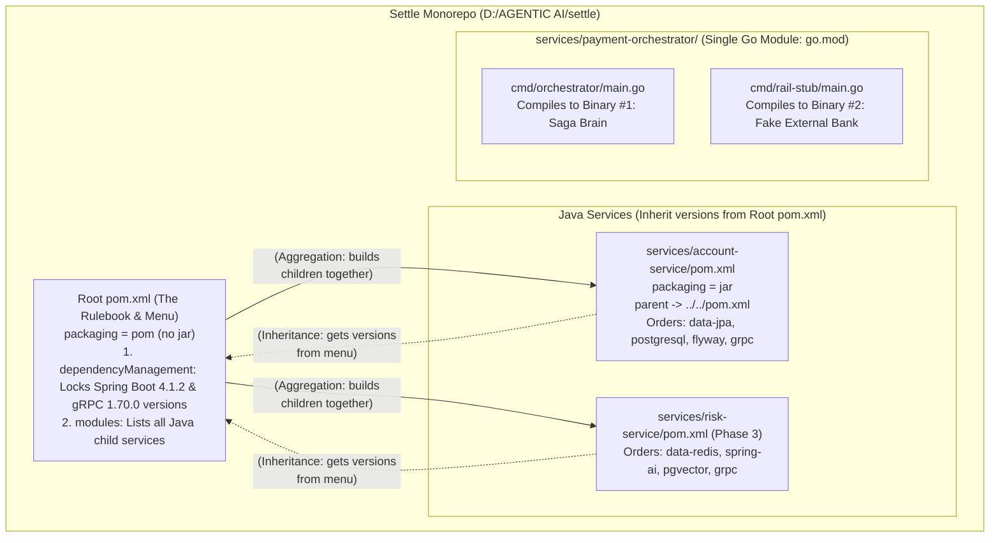

# Topic 01: Maven Multi-Module & Go Modules

---

## 1. Your Question
> *"Why do we have TWO `pom.xml` files in Java (a root `pom.xml` and `services/account-service/pom.xml`)? And why is the Go folder set up with one `go.mod` and two folders inside `cmd/`?"*

---

## 2. Visual Picture: How Root `pom.xml`, Child `pom.xml`, and `go.mod` Fit Together

---

## 3. Detailed Simple-Language Explanation

### A. Why Two `pom.xml` Files in Java?
In Settle, we will have **5 separate Java microservices** (`account-service`, `risk-service`, `notification-service`, `api-gateway`, `identity-service`).
If each service had an isolated `pom.xml`:
1. **Version Chaos ("Jar Hell"):** One service might use Spring Boot `4.1.2` while another accidentally uses `4.0.1` or an incompatible gRPC version.
2. **Manual Building:** You would have to `cd` into 5 folders one-by-one to run `mvn test`.

We solve both by splitting responsibilities between the **Root `pom.xml`** and each **Child `pom.xml`**:

1. **Root [`pom.xml`](../pom.xml) — The "Rulebook & Restaurant Menu":**
   * Has `<packaging>pom</packaging>` because it has **no Java code of its own** and produces no `.jar`.
   * **`<modules>` (Aggregation — Parent points DOWN):** Lists all child Java services so running `mvn test` at the root builds and tests all of them in one command.
   * **`<dependencyManagement>` ("The Restaurant Menu"):** Imports Spring Boot's BOM (Bill of Materials) and gRPC BOM (~300 tested library versions).
     * **Crucial Rule:** Putting a library inside `<dependencyManagement>` does **NOT** download it or add it to any service! It only says: *"IF a child service orders Postgres or Redis later, give it this exact version."*
   * **`<dependencies>` ("Forced on Everyone"):** Anything placed here *is* forced onto every child service. We only put `spring-boot-starter-test` here because every service needs unit testing.

2. **Child [`services/account-service/pom.xml`](../services/account-service/pom.xml) — The "Customer Order":**
   * **`<parent>` (Inheritance — Child points UP):** Points to `../../pom.xml` to inherit Java 21 and the version menu.
   * **`<dependencies>`:** Lists only the libraries `account-service` actually needs (`spring-boot-starter-data-jpa`, `postgresql`, `flyway`, `grpc-*`), **without `<version>` tags** (because the parent's menu decides the versions!).

---

### B. Concrete Example: What Happened in Our "Break-It" Experiment
When we temporarily moved `spring-boot-starter-data-redis` out of `<dependencyManagement>` and into `<dependencies>` in the Root `pom.xml` and ran `mvn dependency:tree`:
* Even though `account-service` never asked for Redis, Redis and Lettuce jars were forcibly injected into `account-service`!
* Keeping libraries in `<dependencyManagement>` in the root POM and `<dependencies>` in the child POM keeps every microservice lean.

---

### C. Why One `go.mod` with Two Folders Inside `cmd/`?
In Go (`services/payment-orchestrator/`):
* **[`go.mod`](../services/payment-orchestrator/go.mod)** is Go's equivalent of `pom.xml` (tracks module import path, Go version, and library versions).
* In Go, every folder containing `package main` and `func main()` compiles into **one standalone executable binary (`.exe`)**.
* Putting both [`cmd/orchestrator/main.go`](../services/payment-orchestrator/cmd/orchestrator/main.go) and [`cmd/rail-stub/main.go`](../services/payment-orchestrator/cmd/rail-stub/main.go) inside one Go module lets them compile and run as **two completely separate servers**, while sharing common internal packages (like webhook HMAC signature helpers) without duplicating code.

---

## 4. Interview Questions & How to Answer Them

### Q1: What is the difference between `<dependencies>` and `<dependencyManagement>` in a Maven parent POM?
* **Winning Answer:**
  "`<dependencyManagement>` is purely a version lookup table—it declares which version of a library *should* be used if a child module requests it, without adding anything to any child's classpath. `<dependencies>` in a parent POM actually forces that dependency onto every child module's classpath. In a microservices monorepo, we import the Spring Boot and gRPC BOMs inside `<dependencyManagement>` so all services share compatible versions, while declaring actual `<dependencies>` in each child POM so `account-service` doesn't pull in AI or Redis libraries it doesn't use."

### Q2: What happens phase-by-phase when you run `mvn package`?
* **Winning Answer:**
  "Maven's default lifecycle is sequential—running any phase automatically runs every phase before it:
  1. `validate`: checks `pom.xml` is valid.
  2. `compile`: compiles `src/main/java` into `.class` files in `target/classes`.
  3. `test`: compiles and runs unit/integration tests in `src/test/java` using Surefire.
  4. `package`: bundles the compiled classes into `target/account-service.jar`, and `spring-boot-maven-plugin`'s `repackage` goal wraps it with all dependencies into a runnable fat JAR."
