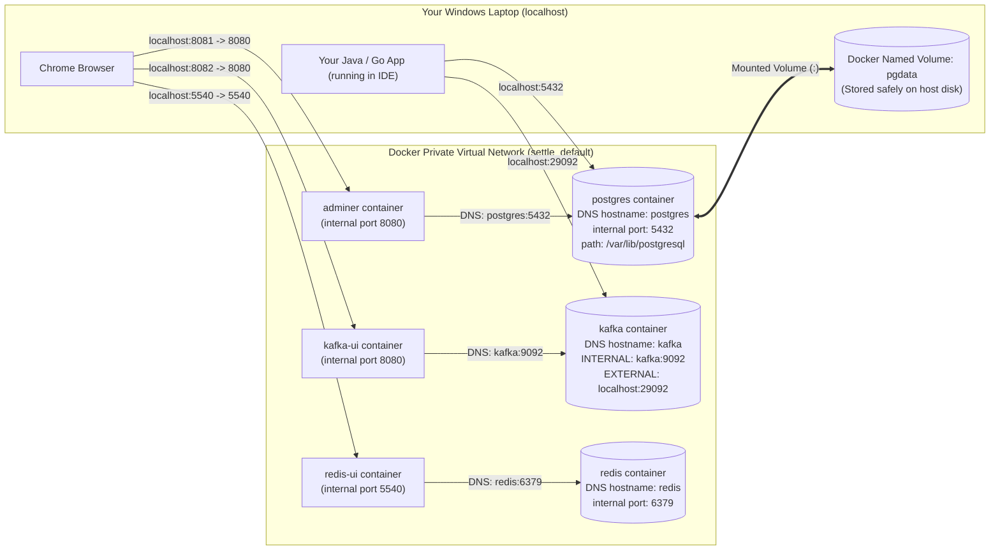

# Topic 02: Docker Compose, Volumes, Internal DNS & Storage Choices

---

## 1. Your Questions
1. *"In `pgdata:/var/lib/postgresql`, where is `/var/lib/postgresql` located?"*
2. *"The UI containers (`adminer`, `kafka-ui`, `redis-ui`) have different images and ports—how do they connect to Postgres, Kafka, and Redis?"*
3. *"Why are we using Postgres, Redis, and Kafka instead of S3?"*

---

## 2. Visual Picture: Docker Private Network, Ports & Named Volumes

---

## 3. Detailed Simple-Language Explanation

### A. How Docker Volumes Work (`OUTSIDE_HOST : INSIDE_CONTAINER`)
Every volume mapping in [`deploy/docker-compose.yml`](../deploy/docker-compose.yml) has two sides separated by a colon (`:`):
* **Right side (`/var/lib/postgresql`) — Inside the Linux Container:**
  This folder is inside the Postgres container's isolated Linux machine (not on your Windows `C:` or `D:` drive). It is the default folder where Postgres saves all its database tables and rows.
* **Left side (`pgdata`) — Outside the Container (Managed by Docker Desktop):**
  * When the left side is just a name (`pgdata`), it is a **Docker Named Volume** stored safely in Docker Desktop's WSL2 virtual disk (`docker volume ls`).
  * When the left side starts with `./` (`./postgres/init:/docker-entrypoint-initdb.d:ro`), it is a **Bind Mount** pointing directly to a visible folder on your Windows drive (`D:\AGENTIC AI\settle\deploy\postgres\init`).
* **Concrete Example (What We Saw in Our Break-It Experiment):**
  Without `pgdata:/var/lib/postgresql`, creating a table `test_money` with `500` and running `docker compose down` destroyed the container and deleted the `500`. Adding `pgdata:/var/lib/postgresql` links `/var/lib/postgresql` to the persistent `pgdata` box outside the container, so `500` survives `docker compose down` and `up -d`!

---

### B. How Containers Connect to Each Other (Docker Internal DNS)
When you run `docker compose up -d`, Docker creates a **private virtual Wi-Fi network** (`settle_default`) and runs a **built-in DNS server**:
* Every service name in `docker-compose.yml` (`postgres`, `kafka`, `redis`) automatically becomes a **hostname** on that network.
* **Why typing `localhost` inside Adminer or Redis UI fails:**
  Each container is its own isolated mini-computer. If `adminer` tries to connect to `localhost:5432`, it looks inside the `adminer` container itself and finds no Postgres running there! Instead, `adminer` connects to **`postgres`** (port `5432`), `kafka-ui` connects to **`kafka:9092`**, and `redis-ui` connects to **`redis:6379`**.
* **Why both `adminer` and `kafka-ui` can use `:8080` on the right side (`"8081:8080"` and `"8082:8080"`):**
  In `WINDOWS_PORT:CONTAINER_PORT`, the right side is the container's private internal port (each container has its own private IP address, so both can use `8080` internally). The left side is your Windows laptop's `localhost`, which must use different ports (`localhost:8081` vs `localhost:8082`).

---

### C. Why Postgres + Redis + Kafka (and Not S3)?
| Storage System | Type | Concrete Example in Settle |
|---|---|---|
| **PostgreSQL** | Relational ACID DB | Stores `accounts`, `holds`, `ledger_entries`. Money movement requires **ACID transactions and row locks (`SELECT ... FOR UPDATE`)** so balances can never turn negative or double-spend. |
| **Redis** | In-Memory Key-Value | Stores rolling velocity counters (*"How many transfers did `acc_A` make in the last 60 seconds?"*) and API Gateway rate limits in `<2ms`. |
| **Apache Kafka** | Distributed Event Log | Buffers `transfer.completed` events so `notification-service` can send emails/webhooks in the background without slowing down the transfer. |
| **Amazon S3** | Object / Blob Storage | Built for **large static files** (PDF statements, KYC photos, nightly batch CSV dumps). Cannot lock rows or run millisecond ACID transactions. |

---

## 4. Interview Questions & How to Answer Them

### Q1: Why does Kafka in Docker need two listeners (`INTERNAL` and `EXTERNAL`)?
* **Winning Answer:**
  "When a client connects to a Kafka bootstrap server, Kafka returns metadata (`KAFKA_ADVERTISED_LISTENERS`) telling the client which hostname and port to use for subsequent partition reads and writes. Other containers inside the Docker network need the internal Docker DNS hostname `kafka:9092` (`INTERNAL`), whereas applications or CLI tools running on the Windows host machine need `localhost:29092` (`EXTERNAL`). Configuring both listeners lets both container clients and host clients talk to the same broker."

### Q2: How does layer caching work in a `Dockerfile`, and why does instruction order matter?
* **Winning Answer:**
  "Each instruction in a `Dockerfile` (`COPY`, `RUN`) creates an immutable read-only image layer. Docker caches and reuses each layer as long as the instruction and copied files haven't changed. Once any layer changes, **every subsequent layer is invalidated and rebuilt**. Therefore, we always `COPY pom.xml` (or `go.mod`) and download dependencies *before* `COPY src/`—so changing a line of Java or Go source code reuses the cached dependency layer instead of re-downloading 200MB of libraries."
