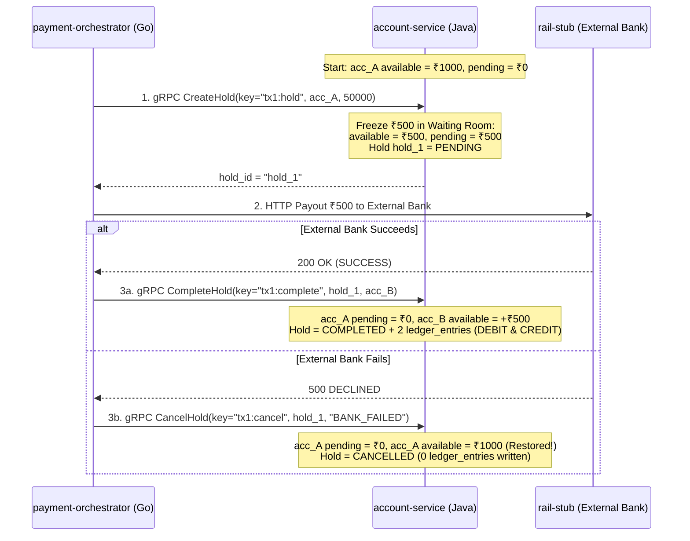
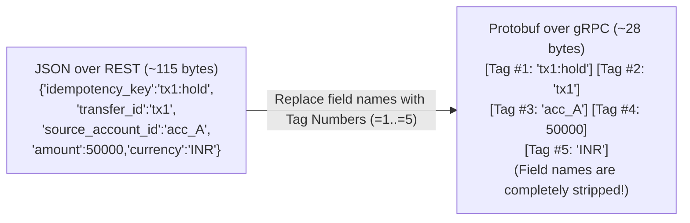

# Topic 03: Protocol Buffers, gRPC & Two-Phase Money Holds (`CreateHold`, `CompleteHold`, `CancelHold`)

---

## 1. Your Questions
1. *"Why does [`account.proto`](../proto/settle/account/v1/account.proto) have 3 methods (`CreateHold`, `CompleteHold`, `CancelHold`) instead of a single `TransferMoney` method?"*
2. *"What is the logic behind every field in `account.proto`, and how do real enterprise companies name them?"*
3. *"How does `.proto` actually work under the hood (`= 1`, `= 2`, etc.)?"*

---

## 2. Visual Picture: Why Two-Phase Holds Are Required & How Protobuf Encodes on the Wire



---

## 3. Detailed Simple-Language Explanation

### A. Why Two-Phase Money Movement (`CreateHold` -> `CompleteHold` / `CancelHold`)?
When a payment calls an outside bank (`rail-stub`), you cannot wrap the outside bank and your Postgres database in a single SQL transaction:
* **Trap 1 (Call external bank first, deduct money second):** While the external bank takes 5 seconds to reply, the user could spend the same ₹500 again in another tab (**Double Spend**).
* **Trap 2 (Deduct money permanently into the passbook first, call external bank second):** If the external bank fails 5 seconds later, your permanent accounting passbook (`ledger_entries`) has a false debit for a transfer that never happened!

**The Solution (The "Waiting Room" / Two-Phase Hold):**
Every account has two balance buckets: **`available_balance`** (spendable now) and **`pending_balance`** (locked in the waiting room).
1. **`CreateHold` (`status = PENDING`):** Moves ₹500 from `available_balance` into `pending_balance` before we call the external bank.
2. **`CompleteHold` (`status = COMPLETED`):** Called only after the external bank succeeds. Moves ₹500 out of `pending_balance`, adds ₹500 to the receiver's `available_balance`, and writes the 2 permanent passbook rows (`DEBIT` and `CREDIT`).
3. **`CancelHold` (`status = CANCELLED`):** Called if the external bank fails. Moves ₹500 from `pending_balance` back to the sender's `available_balance` with zero passbook clutter.

---

### B. How Protobuf Field Numbers (`= 1`, `= 2`) Work on the Network Wire

Look at `CreateHoldRequest` in [`account.proto`](../proto/settle/account/v1/account.proto):
```protobuf
message CreateHoldRequest {
  string idempotency_key = 1;
  string transfer_id = 2;
  string source_account_id = 3;
  int64 amount = 4;
  string currency = 5;
}
```



* **`= 1`, `= 2`, `= 3`, `= 4`, `= 5` are Field Tag Numbers (NOT default values!).**
* On the network wire, **field names like `source_account_id` and `amount` are never sent**—only `[Tag #4 = 50000]` is sent.
* **Concrete Example:**
  * If you rename `int64 amount = 4;` to `int64 amount_in_paise = 4;`, the wire bytes are still `[Tag #4 = 50000]`, so old servers and new servers keep working without breaking.
  * If you change `int64 amount = 4;` to `string amount = 4;`, `buf breaking` immediately flags an error because Tag #4 changed from a binary integer (`varint`) to UTF-8 string bytes!

---

## 4. Interview Questions & How to Answer Them

### Q1: Why is renumbering a field in Protobuf a breaking change, while renaming a field is not?
* **Winning Answer:**
  "Because Protobuf is a binary serialization format that strips field names completely and encodes each field on the wire using its numeric tag (`(field_number << 3) | wire_type`). The receiver uses the field number to match incoming bytes to its compiled schema. Renaming a field only changes generated accessor names in code without changing a single byte on the network, whereas changing a field number or type causes existing clients and servers to misread the binary payload."

### Q2: When would you pick gRPC over REST, and when would you still pick REST?
* **Winning Answer:**
  "I use **gRPC** for **internal microservice-to-microservice calls** (like our Go `payment-orchestrator` calling our Java `account-service` and `risk-service`), because one `.proto` file generates type-safe Go and Java stubs, binary serialization over HTTP/2 multiplexing lowers latency and CPU overhead, and deadlines propagate automatically. I use **REST (JSON over HTTP)** for **external-facing APIs, third-party bank webhooks, and browser UIs** (`api-gateway`, `rail-stub` webhooks, React review UI), where human-readable JSON and universal HTTP tooling (`curl`, browsers) matter most."
