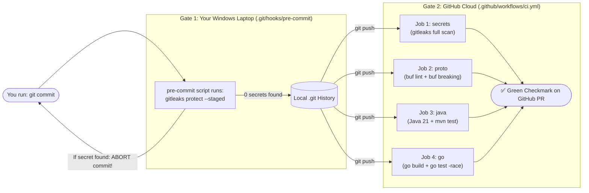

# Topic 04: Git Hooks (`pre-commit`), Secret Scanning (`gitleaks`), and GitHub Actions CI

---

## 1. Your Question
> *"What are `.git/hooks/pre-commit`, `gitleaks`, and `.github/workflows/ci.yml`? I don't know what these are or why we need them."*

---

## 2. Visual Picture: Local `pre-commit` Gate vs Cloud GitHub Actions CI

---

## 3. Detailed Simple-Language Explanation

### A. What is `gitleaks` (Secret Scanning)?
* **The Real-World Disaster:** Developers accidentally leave an OpenAI API key (`sk-...`), AWS key (`AKIA...`), or Postgres password inside a file and run `git push` to GitHub. Automated bots scan public GitHub repos 24/7 and steal leaked keys within 30 seconds.
* **Why deleting the password in a second commit doesn't save you:** Git permanently stores **every past commit** inside `.git` history. Even if you delete the password in Commit #2, anyone can click on Commit #1 on GitHub and read your password.
* **What `gitleaks` does:** It scans your code for patterns that look like secrets (API keys, private keys, tokens) and blocks them.

---

### B. What is [`.git/hooks/pre-commit`](../.git/hooks/pre-commit) (A Local Git Hook)?
Think of `.git/hooks/pre-commit` as an **airport metal detector before you are allowed to board the plane**:
* Every Git repository has a hidden folder called `.git/hooks/`.
* When you place a script named **`pre-commit`** inside `.git/hooks/`, Git **automatically runs that script every single time you type `git commit`**, *before* creating the commit:
  1. You run `git add .` and `git commit -m "add feature"`.
  2. Git pauses and executes `.git/hooks/pre-commit`.
  3. The script runs `gitleaks protect --staged` on your staged files.
  4. **Concrete Example:** When we staged `STRIPE_SECRET_KEY=sk_live_51Nz...` in `fake-secret.txt`, `gitleaks` returned exit code `1` (`leaks found: 1`), and Git aborted the commit so the key never entered `.git` history!

---

### C. What is [`.github/workflows/ci.yml`](../.github/workflows/ci.yml) (GitHub Actions / CI)?
**CI** stands for **Continuous Integration**.
* **The Problem:** Sometimes code works on your laptop (*"It works on my machine!"*) because you forgot to commit a file, or you edited `.proto` and didn't notice it broke a test.
* **How GitHub Actions (`ci.yml`) Solves It:**
  Whenever you push code to GitHub, GitHub boots **4 clean Linux virtual machines in the cloud in parallel** and runs the 4 jobs in `ci.yml`:
  1. **`secrets`:** Scans for leaked secrets in the cloud (in case someone bypassed their local pre-commit hook).
  2. **`proto`:** Runs `buf lint` and `buf breaking` against `main`.
  3. **`java`:** Installs Java 21 and runs `mvn -B test` (which spins up Testcontainers Postgres and runs your integration tests).
  4. **`go`:** Installs Go and runs `go build ./...` and `go test -race ./...`.

---

## 4. Interview Questions & How to Answer Them

### Q1: Why do we scan for secrets in BOTH a local `pre-commit` hook AND in the CI pipeline?
* **Winning Answer:**
  "They provide two layers of defense:
  1. **Local `pre-commit` hook (Prevention):** Stops a secret *before* a commit is even created on the developer's laptop, so the secret never enters `.git` history and never requires rewriting git history or rotating keys.
  2. **CI pipeline (Enforcement):** A developer on a new machine might not have the local git hook installed, or might bypass it with `git commit --no-verify`. Running `gitleaks` in GitHub Actions guarantees that no pull request containing a secret can ever pass CI and merge into `main`."

### Q2: If a developer accidentally pushes an API key to a Git branch, why isn't deleting it in a new commit enough? What must you do?
* **Winning Answer:**
  "Deleting it in a new commit only removes it from the latest `HEAD` snapshot—the secret is still readable in the parent commit's diff inside `.git` history. You must immediately **revoke and rotate the leaked credential** first (assume it is already compromised as soon as it touched a remote repository), and then scrub it from git history using `git filter-repo` or BFG Repo-Cleaner."
