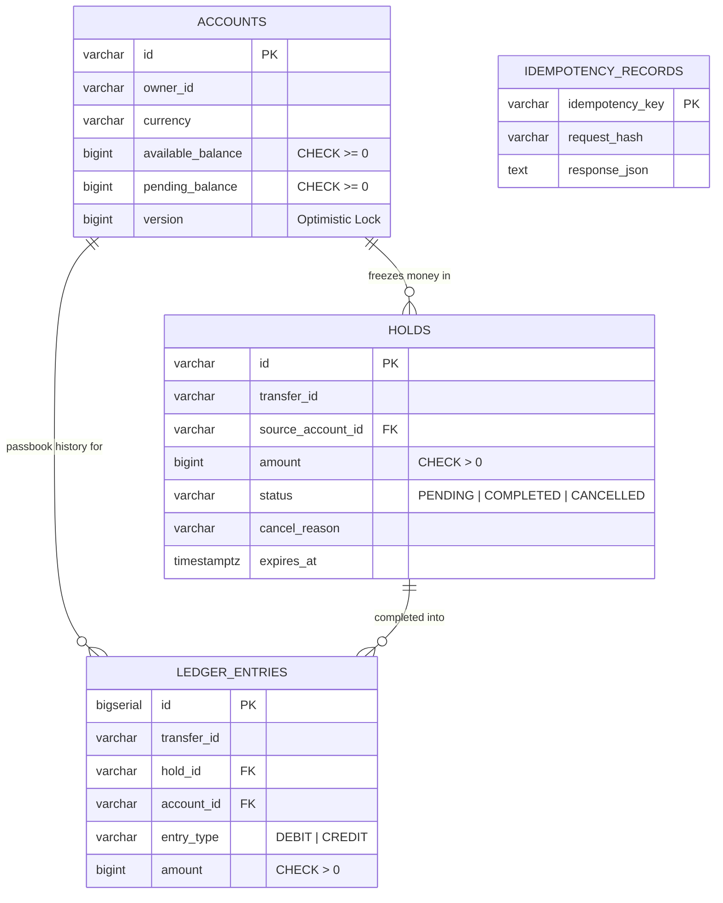
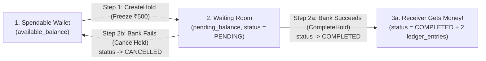

# Topic 05: Designing the 4-Table Ledger Schema (`PENDING` -> `COMPLETED` / `CANCELLED`)

---

## 1. Your Question
> *"How do we design the `account-service` tables from scratch so the balances (`available_balance`, `pending_balance`) and statuses (`PENDING`, `COMPLETED`, `CANCELLED`) are completely intuitive?"*

---

## 2. Visual Picture: Entity-Relationship Diagram & "Waiting Room" Flow

### The "Waiting Room" Flow (`CreateHold` -> `CompleteHold` or `CancelHold`)

---

## 3. Concrete Example: Watch the 4 Tables Change During a ₹500 Transfer

Sayantan (`acc_A`, starts with ₹1,000 = `100000` paise) sends **₹500 (`50000` paise)** to Rahul (`acc_B`, starts with ₹0).

| Step | `acc_A` (`available` / `pending`) | `acc_B` (`available` / `pending`) | `holds` Table (`hold_1`) | `ledger_entries` Table (Passbook) |
|---|---|---|---|---|
| **0. Before Transfer** | `100000` / `0` | `0` / `0` | *(Empty)* | *(Empty)* |
| **1. `CreateHold(acc_A, 50000)`** | **`50000` / `50000`** | `0` / `0` | `hold_1`: **`PENDING`** (`50000`) | *(Empty)* |
| **2a. If Bank Succeeds (`CompleteHold`)** | **`50000` / `0`** | **`50000` / `0`** | `hold_1`: **`COMPLETED`** | Row 1: `DEBIT acc_A 50000` Row 2: `CREDIT acc_B 50000` |
| **2b. If Bank Fails (`CancelHold`)** | **`100000` / `0`** *(Restored!)* | `0` / `0` | `hold_1`: **`CANCELLED`** | *(Empty — 0 passbook rows!)* |

---

## 4. Why We Need Each of the 4 Tables (Step-by-Step Design Thinking)

1. **Table 1: `accounts` (The Wallet):**
   Stores `available_balance` (spendable right now) and `pending_balance` (frozen while talking to the external bank).
   * `CHECK (available_balance >= 0)` guarantees Postgres itself rejects any query that would make a balance negative.
2. **Table 2: `holds` (The Waiting Room Tickets):**
   Why not just use `pending_balance` without a `holds` table? Because Sayantan might start **two transfers at the same time** (₹500 to Rahul, ₹300 to Priya → `pending_balance = ₹800`). The `holds` table gives each freeze its own ticket (`hold_1` for ₹500, `hold_2` for ₹300) and its own status (`PENDING`, `COMPLETED`, `CANCELLED`).
3. **Table 3: `ledger_entries` (The Immutable Double-Entry Passbook):**
   Only written when a hold reaches **`COMPLETED`**. Always writes **2 rows** (`DEBIT` on sender, `CREDIT` on receiver) that are never edited or deleted.
4. **Table 4: `idempotency_records` (The Duplicate-Retry Shield):**
   Remembers every `idempotency_key` (`"tx1:hold"`, `"tx1:complete"`, `"tx1:cancel"`) so network retries return the saved response instead of moving money twice.

---

## 5. Interview Questions & How to Answer Them

### Q1: Why do banks use a Double-Entry Ledger (`ledger_entries` with DEBIT/CREDIT rows) instead of just updating a `balance` column?
* **Winning Answer:**
  "Three reasons:
  1. **Zero-Sum Mathematical Invariant:** Every transfer writes a `DEBIT` (`-amount`) and a `CREDIT` (`+amount`) that sum to zero (`-50000 + 50000 = 0`). Across the entire database, `SUM(CREDIT) - SUM(DEBIT)` must always equal `0`—which lets our invariant checker prove mathematically that zero money was created or lost.
  2. **Append-Only Audit Trail:** Updating a `balance` column overwrites history. An append-only `ledger_entries` table preserves every transaction so any account's true balance can be recomputed and verified from its entries.
  3. **Multi-Party Splits:** If a transfer ever splits ₹500 into ₹490 to a merchant + ₹10 platform fee, `ledger_entries` easily writes 1 `DEBIT` (`50000`) and 2 `CREDIT` rows (`49000` and `1000`) under the same `transfer_id`."
