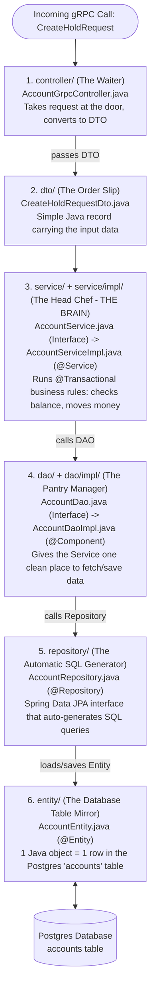

# Topic 06: Spring Boot Enterprise LLD Layers (`Controller`, `DTO`, `Service`, `DAO`, `Repository`, `Entity`)

---

## 1. Your Question
> *"What are `Entity`, `Repository`, `DAO`, `DTO`, `Service`, `ServiceImpl`, and `Controller`? Why do enterprise Java projects split code into all these folders, and how are they connected to each other?"*

---

## 2. The Restaurant Kitchen Analogy (Who Does What)

Imagine a customer (`payment-orchestrator`) walks into a restaurant (`account-service`) and says: *"Put ₹500 on hold for Sayantan (`acc_A`)."*

If one person took the order, ran to the fridge, cooked the food, washed the dishes, and did the accounting in one giant 2,000-line file, the code would be impossible to test or change. So enterprise Java splits the work into **6 clean stations**:



---

## 3. Each Layer Explained in Plain English

### Layer 1: `controller/` — The Waiter ([`AccountGrpcController.java`](../services/account-service/src/main/java/dev/settle/account/controller/AccountGrpcController.java))
* **What it is:** The entry door where network requests arrive (gRPC or REST).
* **Rule:** A Controller must contain **ZERO business logic** and **ZERO database queries**.
* **What it does:** It unpacks the incoming network message (`CreateHoldRequest`), puts the fields into a clean Java **`DTO`** (`CreateHoldRequestDto`), hands it to `accountService.createHold(dto)`, and sends the response back over the network.

### Layer 2: `dto/` — The Paper Order Slip ([`CreateHoldRequestDto.java`](../services/account-service/src/main/java/dev/settle/account/dto/CreateHoldRequestDto.java))
* **Stands for:** **Data Transfer Object**.
* **What it is:** A simple Java `record` (just fields, no database annotations, no gRPC annotations) used to pass data between the `Controller` and the `Service`.
* **Why we don't pass `@Entity` or Protobuf objects directly into the Service:**
  1. **Decoupling:** Tomorrow, if we add a REST API (`AccountRestController`) alongside our gRPC controller, both controllers can convert their input into the exact same `CreateHoldRequestDto` and call `accountService.createHold(dto)`.
  2. **Safety:** Never expose raw database `@Entity` objects directly to outside callers, or an API change could accidentally expose or overwrite internal database columns (like `version`).

### Layer 3: `service/` & `service/impl/` — The Head Chef / Brain ([`AccountService.java`](../services/account-service/src/main/java/dev/settle/account/service/AccountService.java) & [`AccountServiceImpl.java`](../services/account-service/src/main/java/dev/settle/account/service/impl/AccountServiceImpl.java))
* **What it is:** The **only** place where business rules and `@Transactional` live!
* **Why split into an `interface` (`AccountService`) and a class (`AccountServiceImpl`)?**
  * `AccountService` (the interface) defines **WHAT** the service can do (`createHold`, `completeHold`, `cancelHold`).
  * `AccountServiceImpl` (annotated with `@Service`) defines **HOW** it does it.
  * When you put `@Transactional` on `AccountServiceImpl`, Spring creates a **proxy wrapper** around the `AccountService` interface that automatically runs `BEGIN` before your method starts, `COMMIT` when your method finishes, or `ROLLBACK` if your method throws an exception!

### Layer 4: `dao/` & `dao/impl/` — The Pantry Manager ([`AccountDao.java`](../services/account-service/src/main/java/dev/settle/account/dao/AccountDao.java) & [`AccountDaoImpl.java`](../services/account-service/src/main/java/dev/settle/account/dao/impl/AccountDaoImpl.java))
* **Stands for:** **Data Access Object**.
* **Why have a DAO when we already have Repositories?**
  Our database has 4 separate tables (`accounts`, `holds`, `ledger_entries`, `idempotency_records`), which means 4 separate `JpaRepository` interfaces. Instead of injecting 4 repositories into `AccountServiceImpl`, `AccountDao` groups all account-domain persistence operations behind one clean interface (`accountDao.findAccountByIdForUpdate(...)`, `accountDao.saveHold(...)`). And if you ever move one table to Redis or JDBC later, you only change `AccountDaoImpl`—`AccountServiceImpl` doesn't change a single line!

### Layer 5: `repository/` — The Automatic SQL Generator ([`AccountRepository.java`](../services/account-service/src/main/java/dev/settle/account/repository/AccountRepository.java))
* **Look closely at `AccountRepository.java`:** It is an **`interface`** that extends `JpaRepository<AccountEntity, String>`, and **there is no `AccountRepositoryImpl.java` file**!
* **How does it work without an implementation file?**
  At startup, **Spring Data JPA automatically generates the implementation class in memory**!
  * It gives you `.findById()`, `.save()`, `.delete()` for free.
  * When we write `@Lock(LockModeType.PESSIMISTIC_WRITE)` + `@Query("SELECT a FROM AccountEntity a WHERE a.id = :id")`, Spring automatically turns that into the Postgres query:
    `SELECT * FROM accounts WHERE id = ? FOR UPDATE`.

### Layer 6: `entity/` — The Database Row Mirror ([`AccountEntity.java`](../services/account-service/src/main/java/dev/settle/account/entity/AccountEntity.java))
* **What it is:** A Java class annotated with `@Entity` and `@Table(name = "accounts")`.
* **How it works:**
  * **1 `AccountEntity` object in Java = 1 row in the `accounts` table in Postgres.**
  * `@Id` marks the primary key column (`id`).
  * `@Column(name = "available_balance")` links the Java field `availableBalance` to the SQL column `available_balance`.

---

## 4. How Spring Connects All 6 Layers Automatically (Dependency Injection)

Notice that nowhere in our code do we write `new AccountServiceImpl()` or `new AccountDaoImpl()`. How do they get created and connected?

When `SpringApplication.run(AccountServiceApplication.class, args)` starts:
1. **Component Scan:** Spring scans every package inside `dev.settle.account` looking for classes with `@Component`, `@Service`, or `@Repository`.
2. **Bean Creation & Constructor Injection (Bottom-Up):**
   * First, Spring creates the 4 **`Repository`** objects (`AccountRepository`, `HoldRepository`, etc.).
   * Next, Spring sees `AccountDaoImpl` (`@Component`) has a constructor asking for those 4 repositories—so Spring passes them in and creates **`AccountDaoImpl`**.
   * Next, Spring sees `AccountServiceImpl` (`@Service`) has a constructor asking for `AccountDao`—so Spring passes `AccountDaoImpl` in and wraps `AccountServiceImpl` in a `@Transactional` proxy.
   * Finally, Spring sees `AccountGrpcController` (`@Component`) has a constructor asking for `AccountService`—so Spring passes the service in!

---

## 5. Interview Questions & How to Answer Them

### Q1: Why shouldn't a Controller return or accept a JPA `@Entity` directly? Why use a `DTO`?
* **Winning Answer:**
  "Three reasons:
  1. **API Decoupling:** If you expose `@Entity` directly in your controller, renaming a database column breaks external API clients. A DTO decouples the external contract from the internal database schema.
  2. **Security (Mass Assignment / Over-posting):** Accepting an `@Entity` from a client allows an attacker to pass internal fields like `version`, `availableBalance`, or `role` in the request payload.
  3. **LazyInitializationException:** JPA entities often have lazy-loaded relationships; serializing an `@Entity` in the controller outside the `@Transactional` service boundary can trigger `LazyInitializationException` or N+1 queries."

### Q2: How does Spring Boot's Dependency Injection (Inversion of Control) work at startup?
* **Winning Answer:**
  "When `SpringApplication.run()` executes, it creates an `ApplicationContext` (the IoC container). Through `@ComponentScan`, it discovers all classes annotated with `@Component`, `@Service`, `@Repository`, and `@Configuration`, builds a directed acyclic dependency graph from their constructors, instantiates each singleton bean in topological order (repositories first, then DAOs, then services, then controllers), wraps beans that need AOP proxies (like `@Transactional`), and injects them via constructor injection."

---

## 6. Bonus Interview Concept: POJO vs DTO vs Entity vs JavaBean

### What is a POJO?
**POJO** stands for **P**lain **O**ld **J**ava **O**bject.
* It just means a **normal, ordinary Java class** that only has fields, constructors, and getters/setters—and is **not** forced to `extend` or `implement` any special framework classes (like `extends HttpServlet`).
* **Why does the word exist?** In the old Java EE (EJB) days, frameworks forced every class to implement 10 complicated framework methods. Modern Spring/Hibernate lets you write simple **POJOs** and just add lightweight `@Annotations`.

### Quick Comparison Table (Frequently Asked in Java Interviews!)

| Term | What It Is | Example in Our Code |
|---|---|---|
| **POJO** | Any normal Java class with fields + getters/setters (the umbrella term). | Both `CreateHoldRequestDto` and `AccountEntity` are POJOs! |
| **DTO (Data Transfer Object)** | A POJO (or Java `record`) whose **role** is to carry data between layers (Controller ↔ Service) or over the network. Has zero business logic and zero DB annotations. | [`CreateHoldRequestDto.java`](../services/account-service/src/main/java/dev/settle/account/dto/CreateHoldRequestDto.java) |
| **Entity (`@Entity`)** | A POJO annotated with `@Entity`, `@Table`, `@Id` whose **role** is to map 1-to-1 to a row in a database table. | [`AccountEntity.java`](../services/account-service/src/main/java/dev/settle/account/entity/AccountEntity.java) |
| **JavaBean** | A strict type of POJO that follows 3 rules: (1) has a public no-arg constructor, (2) private fields with `getX()`/`setX()`, and (3) implements `Serializable`. | Traditional Spring/JPA entities. |

---

## 7. What is a Java `record` (Used in `dto/`), and Why Not Use `record` for `@Entity`?

### What is `record`?
Introduced in Java 16 (and standard in Java 21), **`record`** is a shortcut for writing an **immutable (read-only) data carrier class**.

When you write these 7 lines in [`CreateHoldRequestDto.java`](../services/account-service/src/main/java/dev/settle/account/dto/CreateHoldRequestDto.java):
```java
public record CreateHoldRequestDto(
        String idempotencyKey,
        String transferId,
        String sourceAccountId,
        long amount,
        String currency
) {}
```
The Java compiler automatically generates ~45 lines of boilerplate for you:
1. **`private final` fields** for all 5 variables (cannot be modified after creation).
2. **A full constructor** (`new CreateHoldRequestDto(idempotencyKey, transferId, sourceAccountId, amount, currency)`).
3. **Getter methods** named after the field without `get`: `dto.amount()`, `dto.sourceAccountId()`, `dto.currency()`.
4. **`equals()`, `hashCode()`, and `toString()`** implementations.

### Interview Question: Why use `record` for `DTO`s, but `class` for JPA `@Entity`?
* **Winning Answer:**
  "A `DTO` is an immutable data envelope sent between layers—once created, its fields should never be mutated, so a Java `record` is ideal. A JPA `@Entity` (like `AccountEntity`) cannot be a `record` because Hibernate requires entities to meet three rules that `record` violates:
  1. A non-final class (so Hibernate can generate runtime proxies).
  2. A parameterless no-arg constructor (`public AccountEntity() {}`) so Hibernate can instantiate it via reflection when reading rows from Postgres.
  3. Mutable state (`setAvailableBalance(...)`) so Hibernate's dirty checking can track changes and issue `UPDATE` statements."
