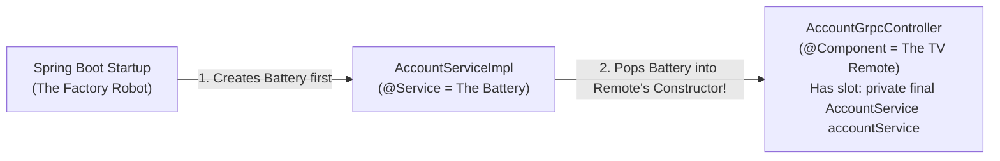

# Topic 07: Dependency Injection (DI), Inversion of Control (IoC), and Constructor Injection

---

## 1. Your Question
> *"In `AccountGrpcController.java`, what do these lines do, and what is Dependency Injection (DI)?"*
> ```java
> private final AccountService accountService;
>
> public AccountGrpcController(AccountService accountService) {
>     this.accountService = accountService;
> }
> ```

---

## 2. Simple Explanation (With Before & After Code)

### Step 1: What happens WITHOUT Dependency Injection?
In `AccountGrpcController`, line 31 calls `accountService.createHold(...)`.
In Java, before you can call a method on `accountService`, an object must be created in memory using `new`.

**Without Spring / Without DI**, you would have to build the entire chain of objects yourself using `new` inside `AccountGrpcController`:

```java
// ❌ WITHOUT Dependency Injection (Hardcoded with "new"):
public class AccountGrpcController {

    private final AccountService accountService;

    public AccountGrpcController() {
        // You have to manually create every single layer with "new"!
        AccountDao dao = new AccountDaoImpl(accountRepo, holdRepo, ledgerRepo, idempRepo);
        this.accountService = new AccountServiceImpl(dao);
    }
}
```
**Why is doing `new AccountServiceImpl(...)` inside the Controller bad?**
1. **Tightly Coupled:** `AccountGrpcController` now has to know how to build `AccountServiceImpl`, `AccountDaoImpl`, and all 4 repositories. If `AccountDaoImpl` adds a 5th repository tomorrow, `AccountGrpcController` breaks!
2. **Impossible to Unit Test:** When testing `AccountGrpcController`, you can't swap `accountService` with a fake/mock object because `new AccountServiceImpl(...)` is hardcoded inside it.
3. **Duplicate Objects:** If 3 different controllers all wrote `new AccountServiceImpl(...)`, you'd have 3 separate copies wasting memory instead of 1 shared service.

---

### Step 2: What IS Dependency Injection (DI)?
Break the two words apart:
* **Dependency:** Any helper object a class needs to do its job. (`AccountGrpcController` needs `AccountService`, so `AccountService` is its **dependency**).
* **Injection:** **Passing that helper object in from the outside** (through the constructor), instead of creating it inside with `new`!

Now look at lines 23–27 of [`AccountGrpcController.java`](../services/account-service/src/main/java/dev/settle/account/controller/AccountGrpcController.java) again:

```java
// ✅ WITH Dependency Injection (Constructor Injection):
@Component
public class AccountGrpcController extends AccountServiceGrpc.AccountServiceImplBase {

    // Line 23: A box to store the AccountService object once someone hands it to us.
    // "final" means once it is set in the constructor, it can never be changed or become null.
    private final AccountService accountService;

    // Lines 25-27: The Constructor.
    // It says: "To create an AccountGrpcController, you MUST pass me a ready-made AccountService!"
    public AccountGrpcController(AccountService accountService) {
        this.accountService = accountService; // Save the passed-in object into our box on Line 23
    }
```

---

### Step 3: Who Calls That Constructor and Hands In `AccountService`?
You never wrote `new AccountGrpcController(...)` anywhere—so who calls that constructor on line 25?

**Spring Boot does!** When your app starts (`SpringApplication.run`), Spring scans your code for `@Repository`, `@Component`, and `@Service`, and essentially executes this wiring code for you behind the scenes:

```java
// What Spring Boot's IoC Container secretly runs at startup:
AccountDao accountDao = new AccountDaoImpl(accountRepo, holdRepo, ledgerRepo, idempRepo);
AccountService accountService = new AccountServiceImpl(accountDao);
AccountGrpcController controller = new AccountGrpcController(accountService); // <-- Spring calls your constructor here!
```

* **Inversion of Control (IoC):** Normally, *your code* is in control of calling `new`. With Spring, control is **inverted**—*Spring* is in control of calling `new` and wiring your objects together.
* **Dependency Injection (DI):** The specific technique Spring uses to wire them together (passing `accountService` into `AccountGrpcController`'s constructor).

---

## 3. Interview Questions & How to Answer Them

### Q1: What is the difference between Inversion of Control (IoC) and Dependency Injection (DI)?
* **Winning Answer:**
  "**Inversion of Control (IoC)** is the broad design principle where the framework (Spring's `ApplicationContext`), rather than your application code, controls the creation and lifecycle of objects. **Dependency Injection (DI)** is the concrete pattern Spring uses to implement IoC—instead of a class instantiating its dependencies with `new`, Spring injects those dependencies into the class at runtime (typically via its constructor)."

### Q2: Why do enterprise projects prefer Constructor Injection (`public AccountGrpcController(AccountService accountService)`) over `@Autowired` Field Injection (`@Autowired private AccountService accountService;`)?
* **Winning Answer:**
  "Three reasons:
  1. **Immutability (`final` fields):** Constructor injection allows dependency fields to be declared `private final`, guaranteeing the object is fully initialized and thread-safe the moment it is constructed.
  2. **Fail-Fast & Null Safety:** You cannot instantiate the class without providing its required dependencies, preventing `NullPointerException`s.
  3. **Easy Unit Testing Without Spring:** In a JUnit test, you can simply call `new AccountGrpcController(mockAccountService)` in plain Java in 1 millisecond without booting the entire Spring context or using reflection."

---

## 4. Visual Analogy: The TV Remote & Battery Slot (Why `this.accountService = accountService`)



Why does the constructor say `this.accountService = accountService;` (using the same name twice)?
* **`this.accountService`** (left side) = The permanent **battery slot** living inside `AccountGrpcController` (declared on line 23).
* **`accountService`** (right side) = The **battery handed in** through the constructor parameter (on line 25).
* If we wrote them with two distinct names, it is simply:
  ```java
  private final AccountService myServiceSlot;

  public AccountGrpcController(AccountService givenService) {
      this.myServiceSlot = givenService;
  }
  ```
