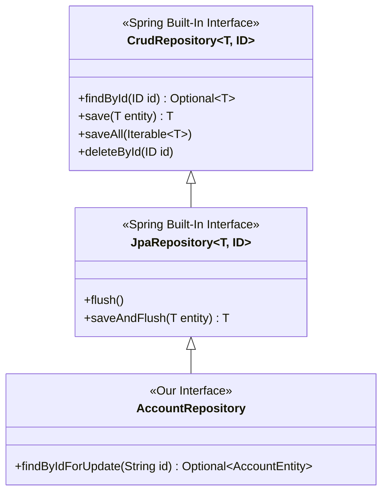

# Topic 08: `DAO` vs `Repository` & Why `findById` Jumps to `CrudRepository.java`

---

## 1. Your Questions
1. *"When I Ctrl+Click `findById` in `AccountDaoImpl`, why does it open Spring's `CrudRepository.java`, whereas when I Ctrl+Click `findByIdForUpdate`, it opens our `AccountRepository.java`?"*
2. *"What is the actual use of having both a `dao/` folder and a `repository/` folder?"*

---

## 2. Question 1: Why `findById` Goes to `CrudRepository.java` vs `findByIdForUpdate` Going to `AccountRepository.java`

Look at line 13 of [`AccountRepository.java`](../services/account-service/src/main/java/dev/settle/account/repository/AccountRepository.java):
```java
@Repository
public interface AccountRepository extends JpaRepository<AccountEntity, String> {

    @Lock(LockModeType.PESSIMISTIC_WRITE)
    @Query("SELECT a FROM AccountEntity a WHERE a.id = :id")
    Optional<AccountEntity> findByIdForUpdate(@Param("id") String id);
}
```

Notice **`extends JpaRepository<AccountEntity, String>`**!
In Spring Data JPA, `JpaRepository` extends `CrudRepository`:



* **Why `findById` and `save` open `CrudRepository.java`:**
  Every table in every app needs basic CRUD (`findById`, `save`, `deleteById`). So Spring already declared those methods inside its built-in `CrudRepository.java` interface! Because `AccountRepository extends JpaRepository` (which extends `CrudRepository`), our `AccountRepository` **inherits** `findById` and `save` for free.
* **Why `findByIdForUpdate` opens `AccountRepository.java`:**
  Spring's built-in `CrudRepository` does **not** have a method that locks a row with `SELECT ... FOR UPDATE`. So we defined our own custom method `findByIdForUpdate` inside [`AccountRepository.java`](../services/account-service/src/main/java/dev/settle/account/repository/AccountRepository.java) using `@Lock(LockModeType.PESSIMISTIC_WRITE)` and `@Query(...)`.

### How Does Spring Execute Both Without Us Writing SQL Code?
At startup, Spring Data JPA generates a dynamic proxy class in memory (backed by Spring's `SimpleJpaRepository` class) that implements both the inherited `CrudRepository` methods (`findById`, `save`) AND any custom `@Query` methods (`findByIdForUpdate`) you added to `AccountRepository`!

---

## 3. Question 2: Why Have Both `dao/` (`AccountDao`) and `repository/` (`AccountRepository`)?

| Layer | Scope | What It Does |
|---|---|---|
| **`repository/` (`*Repository`)** | **1 Table = 1 Repository** (Tightly tied to Spring Data JPA) | `AccountRepository` only knows the `accounts` table; `HoldRepository` only knows `holds`; `LedgerEntryRepository` only knows `ledger_entries`; `IdempotencyRecordRepository` only knows `idempotency_records`. |
| **`dao/` (`AccountDao` + `AccountDaoImpl`)** | **Domain Storage Facade** (Wraps multiple repositories / storage engines) | Combines all 4 table repositories behind one clean interface (`AccountDao`) for `AccountServiceImpl`. |

### 3 Reasons Enterprise Projects Keep a `DAO` Layer Over `Repository`:
1. **Cleaner Service Constructor:** `AccountServiceImpl` only injects **1 dependency** (`AccountDao`) instead of injecting 4 or 5 separate `*Repository` interfaces.
2. **Hiding Storage Technology from Business Logic:** `AccountServiceImpl` doesn't know or care whether `AccountDao` uses Spring Data JPA (`JpaRepository`), raw SQL (`JdbcTemplate`), or Redis cache + Postgres. If tomorrow you cache `findAccountById` in Redis or switch a hot query to `JdbcTemplate`, you only edit `AccountDaoImpl`—`AccountServiceImpl` doesn't change at all.
3. **Clearer Mocking in Unit Tests:** When unit-testing `AccountServiceImpl`, you only mock 1 interface (`AccountDao`) instead of setting up mocks for 4 separate JPA repositories.

---

## 4. Interview Questions & How to Answer Them

### Q1: What is the difference between a `DAO` and a Spring Data `Repository`?
* **Winning Answer:**
  "In Spring Boot, a `JpaRepository` is a framework-provided interface tied 1-to-1 to a single JPA `@Entity` table, providing auto-generated CRUD and query methods. A `DAO` (Data Access Object) is a broader persistence abstraction layer that we write to encapsulate how domain data is stored and retrieved—often coordinating across multiple JPA repositories, `JdbcTemplate` queries, or caches so the `@Service` layer stays completely decoupled from the underlying persistence mechanism."

### Q2: How does Spring Data JPA execute a method in `AccountRepository` when `AccountRepository` is just an interface with no implementation class?
* **Winning Answer:**
  "During component scanning at startup, Spring Data's `JpaRepositoryFactory` detects every interface extending `Repository` or `JpaRepository` and creates a JDK Dynamic Proxy for it. By default, standard CRUD calls (`findById`, `save`) are delegated to Spring's built-in `SimpleJpaRepository` implementation (which calls `EntityManager.find()` or `EntityManager.persist()`). Custom methods are either parsed from their method name (`findByAccountIdOrderByIdAsc`) or from their `@Query` / `@Lock` annotations into JPQL/SQL executed against the `EntityManager`."
