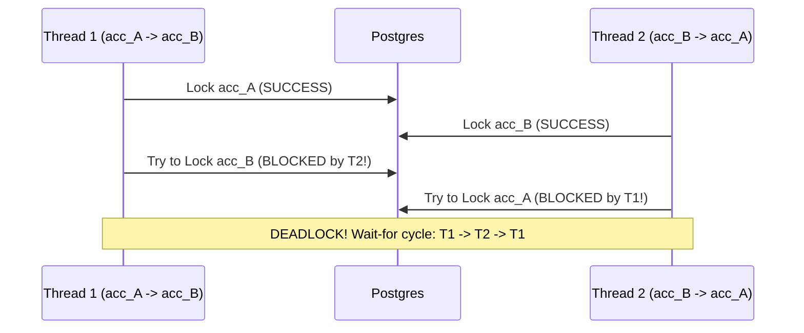

# Topic 09: Pessimistic vs Optimistic Locking & Deadlock Prevention in Payment Ledgers

---

## 1. The Core Problem: Why `completeHold` Can Deadlock Without Ordered Locking

In `completeHold`, we must update **two accounts** in one `@Transactional` method:
* **Sender (`sourceAccountId`)**: subtract `amount` from `pending_balance`
* **Receiver (`destinationAccountId`)**: add `amount` to `available_balance`

### What happens if you naively lock `sourceAccountId` first and `destinationAccountId` second?
Suppose two users send money to each other at the exact same millisecond:
* **Thread 1 (Sayantan `acc_A` -> Rahul `acc_B`):**
  1. Locks **`acc_A`** (`SELECT * FROM accounts WHERE id = 'acc_A' FOR UPDATE`)
  2. Tries to lock **`acc_B`**... *(waits because Thread 2 holds `acc_B`)*
* **Thread 2 (Rahul `acc_B` -> Sayantan `acc_A`):**
  1. Locks **`acc_B`** (`SELECT * FROM accounts WHERE id = 'acc_B' FOR UPDATE`)
  2. Tries to lock **`acc_A`**... *(waits because Thread 1 holds `acc_A`)*



### The Fix: Deterministic Lock Ordering (Always Lock in Alphabetical ID Order)
Before locking two accounts, compare their IDs (`sourceId.compareTo(destId) < 0`) and **always lock the smaller ID first, and the larger ID second**:
* **Thread 1 (`acc_A` -> `acc_B`):** `"acc_A" < "acc_B"` → Locks **`acc_A` first**, then **`acc_B`**.
* **Thread 2 (`acc_B` -> `acc_A`):** `"acc_A" < "acc_B"` → Also tries to lock **`acc_A` first**, then **`acc_B`**!
* Because Thread 1 already holds `acc_A`, Thread 2 waits at Step 1 before ever grabbing `acc_B`. A circular wait (`T1 -> T2 -> T1`) is mathematically impossible!

---

## 2. Interview Questions & How to Answer Them

### Q1: When should you use Optimistic Locking (`@Version`) vs Pessimistic Locking (`SELECT ... FOR UPDATE`)?
* **Winning Answer:**
  "**Optimistic Locking (`@Version`)** assumes conflicts are rare: it doesn't lock the row on read, and instead checks `WHERE version = old_version` on `UPDATE`. If another thread modified the row first, it throws `OptimisticLockException` and the caller must retry. It's great for low-contention profile updates.
  **Pessimistic Locking (`SELECT ... FOR UPDATE`)** locks the database row immediately on read so concurrent transactions queue up in Postgres instead of failing and retrying. In a payment ledger where hot accounts (like merchant or clearing accounts) receive many concurrent transfers, pessimistic locking with deterministic ID ordering avoids retry storms while `@Version` acts as a secondary safety belt."

### Q2: How does Postgres detect a deadlock if one occurs?
* **Winning Answer:**
  "When a transaction waits for a row lock longer than `deadlock_timeout` (default `1s`), Postgres constructs a directed **wait-for graph** where nodes are transactions and edges point from waiting transactions to lock-holding transactions. If Postgres detects a cycle in the graph, it aborts one of the transactions with SQLSTATE `40P01` (`deadlock_detected`) so the other can proceed."

---

## 3. Plain-English Analogy: What is a Thread, a Lock, and a Deadlock? (The 2 Cashiers & 2 Folders Story)

### 1. What is a "Thread"? (= A Bank Cashier)
If a bank only had **1 Cashier**, only 1 customer could be served at a time.
So your Java server has **many Cashiers (Threads)** working at the same time:
* When User 1 clicks "Pay", **Cashier 1 (Thread 1)** runs `completeHold` for User 1.
* If User 2 clicks "Pay" at the exact same millisecond, **Cashier 2 (Thread 2)** runs `completeHold` for User 2 at the same time.

### 2. What is a "Row Lock" (`findAccountByIdForUpdate`)? (= Taking a Folder from the Cabinet)
In the bank's filing cabinet (Postgres `accounts` table), there is **Folder A (`acc_A`)** and **Folder B (`acc_B`)**.
To stop two cashiers from scribbling over the same folder at the same time, **locking a row** means a cashier physically takes that folder to their desk. Nobody else can touch that folder until the cashier finishes and puts it back.

### 3. What is a "Deadlock"? (= Two Cashiers Holding What the Other Needs)
To move money between A and B, a cashier must have **BOTH Folder A and Folder B on their desk at the same time**.
Suppose at the exact same second:
* **Cashier 1 (A -> B)** grabs their sender folder first: **Folder A**.
* **Cashier 2 (B -> A)** grabs their sender folder first: **Folder B**.
* Next, **Cashier 1** asks for **Folder B** (can't get it—Cashier 2 is holding it!).
* And **Cashier 2** asks for **Folder A** (can't get it—Cashier 1 is holding it!).
* Neither cashier can finish and put their folder back until they get the second folder. **Both cashiers are frozen forever = DEADLOCK!**

### 4. Why "Always Grab Folder A First" Makes Deadlock Impossible
If we make one rule: **"Whether you are sending A->B or B->A, you must ALWAYS pick up Folder A first, and Folder B second"**:
1. Both Cashier 1 and Cashier 2 walk to **Folder A** first.
2. Cashier 1 gets **Folder A**.
3. Cashier 2 sees Folder A is taken, so Cashier 2 **waits empty-handed** (leaving **Folder B** free in the cabinet!).
4. Cashier 1 freely grabs **Folder B**, finishes the transfer, and puts both folders back.
5. Then Cashier 2 grabs Folder A and Folder B and finishes!

---

## 4. Deep Dive: How `findByIdForUpdate` Actually Locks in Postgres & What `save()` Does

### A. How `findAccountByIdForUpdate` Locks a Row (And When It Unlocks!)
1. In [`AccountRepository.java`](../services/account-service/src/main/java/dev/settle/account/repository/AccountRepository.java), we wrote:
   ```java
   @Lock(LockModeType.PESSIMISTIC_WRITE)
   @Query("SELECT a FROM AccountEntity a WHERE a.id = :id")
   Optional<AccountEntity> findByIdForUpdate(@Param("id") String id);
   ```
2. The annotation **`@Lock(LockModeType.PESSIMISTIC_WRITE)`** makes Hibernate append **`FOR UPDATE`** to the SQL sent to Postgres:
   ```sql
   SELECT * FROM accounts WHERE id = 'acc_A' FOR UPDATE;
   ```
3. **What `FOR UPDATE` does in Postgres:** It puts a row-level exclusive lock on `'acc_A'`. Any other thread running `SELECT ... FOR UPDATE` or `UPDATE` on `'acc_A'` is paused by Postgres until our transaction ends.
4. **Why is there no `unlock()` method?**
   Row locks in Postgres are scoped to the database transaction (`@Transactional`). The instant the `@Transactional` method finishes and Spring executes `COMMIT` (or `ROLLBACK` on exception), **Postgres automatically releases all `FOR UPDATE` locks**.

### B. What Do `saveAccount`, `saveHold`, and `saveLedgerEntries` Actually Do?
When you write `account.setAvailableBalance(50000)` in Java, you only changed the variable in **Java RAM**—Postgres hasn't changed yet.
* **For a brand-new row** (`saveHold(new HoldEntity(...))` or `saveLedgerEntries(List.of(debit, credit))`):
  Spring Data's `.save()` / `.saveAll()` calls `EntityManager.persist()`, which generates an **`INSERT INTO ...`** SQL statement.
* **For an existing row loaded from Postgres** (`saveAccount(account)`):
  Hibernate tracks the loaded entity in its **Persistence Context** (1st-level cache). At the end of the `@Transactional` method (on flush/commit), Hibernate detects which fields changed (**Dirty Checking**) and generates an **`UPDATE accounts SET available_balance = ?, pending_balance = ?, version = version + 1 WHERE id = ? AND version = ?`** statement.
