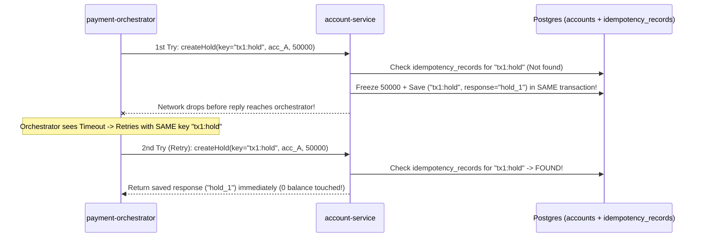

# Topic 10: Idempotency Keys — Preventing Double Charges on Network Retries

---

## 1. The Real-Life Disaster Without Idempotency Keys

Suppose the Go `payment-orchestrator` calls `createHold` on `account-service` to freeze ₹500 on Sayantan's account:
1. `account-service` freezes ₹500 (`available_balance`: ₹1,000 → ₹500, `pending_balance`: ₹0 → ₹500) and commits to Postgres.
2. **Right as `account-service` sends the `"OK (hold_1)"` reply over the network, the Wi-Fi / network glitches for 1 millisecond!**
3. The orchestrator never received `"OK (hold_1)"`—it only saw `"Network Timeout"`.
4. So the orchestrator **retries** the exact same call (`createHold` for ₹500)!
5. **Without an Idempotency Key:** `account-service` treats the retry as a brand-new request and freezes **another ₹500** (`available_balance` drops to ₹0, `pending_balance` becomes ₹1,000 — **a double charge!**).

---

## 2. How Our `idempotency_records` Table Solves It

Every request carries an `idempotency_key` (e.g. `"tx_1:hold"`), and our table stores 3 columns:
1. **`idempotency_key` (`PRIMARY KEY`):** `"tx_1:hold"`
2. **`request_hash`:** A fingerprint of the input parameters (e.g., `"createHold:acc_A:50000:INR"`).
   * **Why check `request_hash`?** If a buggy client accidentally sends `"tx_1:hold"` the first time with `50000` (₹500), and later reuses `"tx_1:hold"` with `90000` (₹900), checking `request_hash` catches the mismatch and throws an error instead of returning the ₹500 receipt for a ₹900 request!
3. **`response_json`:** The saved response (e.g. `"hold_1:50000:50000"`) so we can reconstruct and return the exact same `CreateHoldResponseDto` on a retry!

---

## 3. Interview Questions & How to Answer Them

### Q1: How do you prevent a double charge if a client times out and retries a payment request?
* **Winning Answer:**
  "Every mutating payment endpoint requires a client-generated `Idempotency-Key` (for saga steps, we derive it deterministically as `{transfer_id}:{step}`). Inside the same `@Transactional` database transaction that mutates the account balance and creates the hold, we insert the `idempotency_key`, a hash of the request payload, and the serialized response into an `idempotency_records` table with a `PRIMARY KEY` / `UNIQUE` constraint on `idempotency_key`. If the client times out and retries with the same key, we find the existing record, verify the `request_hash` matches, and return the stored response without re-applying the balance change. And if the transaction rolled back on the first attempt, the idempotency row rolled back with it, so the retry cleanly executes."

### Q2: What happens if two identical requests with the SAME `idempotency_key` arrive at the exact same millisecond in parallel?
* **Winning Answer:**
  "Both threads may check `findIdempotencyRecord(key)` at the start and see nothing. However, when they proceed to `findAccountByIdForUpdate(accountId)`, the second thread blocks on the Postgres row lock until the first thread commits. Even if they touched different rows, the `PRIMARY KEY` (`UNIQUE`) constraint on `idempotency_records.idempotency_key` acts as the final line of defense in Postgres—preventing two transactions with the same key from ever both committing."

---

## 4. Deep Dive: Why Check `idempotency_records` AFTER Locking the Account Row (`findAccountByIdForUpdate`)?

Suppose a client fires **2 identical requests (`key = "tx_1:hold"`) at the exact same millisecond** in parallel:

### ❌ What Happens If You Check `idempotency_records` BEFORE Locking the Account:
1. **Millisecond 1:** Thread 1 checks `idempotency_records` for `"tx_1:hold"` → **Not found** (because Thread 1 hasn't finished yet).
2. **Millisecond 1 (same instant!):** Thread 2 ALSO checks `idempotency_records` for `"tx_1:hold"` → **Not found!**
3. **Millisecond 2:** Both Thread 1 and Thread 2 passed the `if (existing.isPresent())` check! Thread 1 locks the account, deducts ₹500, inserts `"tx_1:hold"`, and commits. Then Thread 2 gets the lock, deducts **another ₹500**, tries to insert `"tx_1:hold"`, and crashes with a `DataIntegrityViolationException` (Duplicate Primary Key)!

### ✅ What Happens When You Lock the Account FIRST, Then Check `idempotency_records`:
1. **Millisecond 1:** Both Thread 1 and Thread 2 hit `findAccountByIdForUpdate("acc_A")` first.
   * Thread 1 gets the lock on `"acc_A"`.
   * **Thread 2 is paused right there by Postgres** (before Thread 2 even checks `idempotency_records`!).
2. **Millisecond 2:** Thread 1 checks `idempotency_records` (not found), freezes ₹500, saves `"tx_1:hold"` into `idempotency_records`, and commits (releasing the lock on `"acc_A"`).
3. **Millisecond 3:** Postgres wakes up Thread 2. Thread 2 now checks `idempotency_records` on the very next line—and **sees the row Thread 1 just committed!** Thread 2 immediately returns the saved response cleanly without deducting money or crashing!
