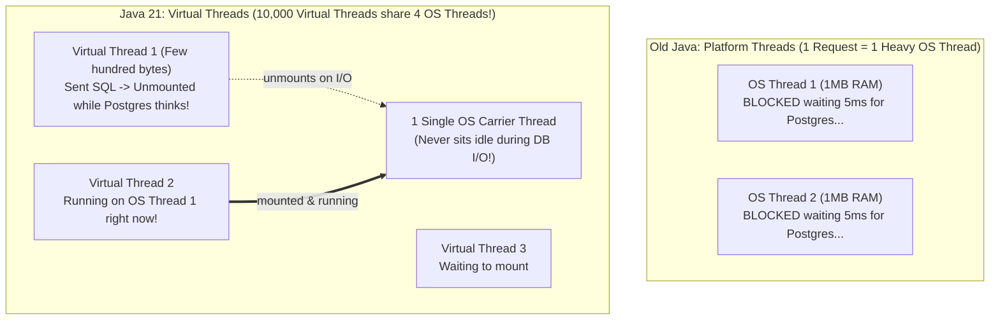

# Topic 11: Java 21 Virtual Threads & gRPC Status Code Mapping

---

## 1. Platform Threads vs Java 21 Virtual Threads (Project Loom)

Look at [`GrpcServerConfig.java`](../services/account-service/src/main/java/dev/settle/account/config/GrpcServerConfig.java) and [`application.yml`](../services/account-service/src/main/resources/application.yml):
```java
.executor(Executors.newVirtualThreadPerTaskExecutor())
```

### A. Old Java: Platform Threads (1 Java Thread = 1 OS Kernel Thread)
* An Operating System thread costs **~1 MB of RAM** for its call stack and takes thousands of CPU cycles for the OS kernel to context-switch.
* A typical server can only run ~200–500 platform threads.
* **The Problem with Blocking I/O (`SELECT ... FOR UPDATE` in Postgres):**
  When a platform thread waits 5 milliseconds for Postgres to reply over the network, **that entire 1 MB OS thread sits completely idle (blocked)** and cannot serve any other request! If 500 requests wait on Postgres at the same time, the server runs out of threads and rejects new traffic.

### B. Java 21: Virtual Threads (Millions of Lightweight Threads Managed by the JVM)
* A **Virtual Thread** is managed by the JVM (extremely similar to **Go's goroutines**!) and costs only **a few hundred bytes of heap memory** instead of 1 MB.
* **What happens when a Virtual Thread blocks on Postgres (`findAccountByIdForUpdate`)?**
  The instant the Virtual Thread waits for network/database I/O, **the JVM unmounts the Virtual Thread from the underlying OS carrier thread** and puts another Virtual Thread on that OS thread!
* When Postgres replies 5ms later, the JVM mounts the Virtual Thread back onto an available OS thread and continues line-by-line.
* **Result:** You get to write simple, synchronous, readable `@Transactional` code (no reactive `Mono`/`Flux` callback spaghetti!) while handling **10,000+ concurrent requests** on just 8 OS threads!

---

## 2. Why Map Java Exceptions to gRPC Status Codes?

In [`AccountGrpcController.java`](../services/account-service/src/main/java/dev/settle/account/controller/AccountGrpcController.java), we map Java exceptions to gRPC `Status` codes:
* `Account not found` → **`Status.NOT_FOUND`** (Permanent error: Orchestrator must **not** retry!)
* `Currencies do not match` / `Amount <= 0` → **`Status.INVALID_ARGUMENT`** (Permanent error: do **not** retry!)
* `Insufficient available balance` → **`Status.FAILED_PRECONDITION`** (Permanent business rejection: do **not** retry!)
* Database connection blip → **`Status.INTERNAL` / `Status.UNAVAILABLE`** (Transient error: Orchestrator **should** retry with backoff!)

---

## 3. Interview Questions & How to Answer Them

### Q1: What is the difference between Platform Threads and Virtual Threads in Java 21? When do Virtual Threads NOT help?
* **Winning Answer:**
  "**Platform threads** are 1-to-1 wrappers around OS kernel threads (~1MB stack memory each); when a platform thread performs blocking I/O (like a JDBC database query), the underlying OS thread is blocked. **Virtual threads** are lightweight user-mode threads managed by the JVM (~hundreds of bytes) multiplexed onto a small pool of OS carrier threads (`ForkJoinPool`). When a virtual thread hits blocking I/O, the JVM unmounts it from the carrier thread so the carrier thread can run other virtual threads.
  **When Virtual Threads do NOT help:**
  1. **CPU-bound workloads** (e.g., video encoding, heavy cryptography, crunching arrays in memory without I/O)—virtual threads don't make a CPU core run faster.
  2. **Thread Pinning** (in Java 21, blocking inside a `synchronized` block or native JNI call pins the virtual thread to its OS carrier thread; using `ReentrantLock` avoids pinning)."

---

## 4. Visual Comparison: Platform Threads vs Java 21 Virtual Threads


