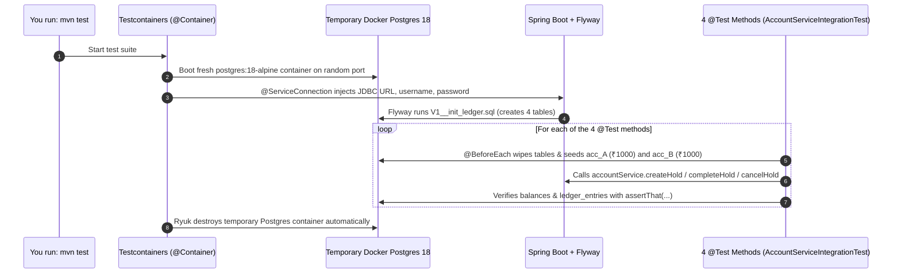

# Topic 12: Integration Testing with Testcontainers (`@Testcontainers` & `@ServiceConnection`)

---

## 1. What Problem Did Testcontainers Just Solve?

When we first ran `mvn test`, it tried to connect to `localhost:5432` and failed with:
`FATAL: password authentication failed for user "settle"` (because `application.yml` had the default password `change-me`, while your local Docker container had a custom password in `deploy/.env`).

Even worse: what happens when GitHub Actions CI runs `mvn test` in the cloud? There is no local `deploy/.env` or pre-running Postgres container in CI!

### How `@Testcontainers` + `@ServiceConnection` Solved It in 3 Lines:
Look at lines 40–42 of [`AccountServiceIntegrationTest.java`](../services/account-service/src/test/java/dev/settle/account/AccountServiceIntegrationTest.java):
```java
@Container
@ServiceConnection
static PostgreSQLContainer<?> postgres = new PostgreSQLContainer<>("postgres:18-alpine");
```
1. **`@Container static PostgreSQLContainer`:** When JUnit starts `AccountServiceIntegrationTest`, Testcontainers talks to Docker and automatically boots a **brand-new, temporary `postgres:18-alpine` container** on a random free port (e.g., `localhost:52850`).
2. **`@ServiceConnection` (Spring Boot 3.1+ / 4.x):** Automatically overrides `spring.datasource.url`, `username`, and `password` with that temporary container's credentials!
3. **Flyway Migration (`V1__init_ledger.sql`):** Automatically runs against that temporary Postgres container to create your 4 tables (`accounts`, `holds`, `ledger_entries`, `idempotency_records`).
4. **Automatic Cleanup (`ryuk`):** The moment the 4 tests finish, Testcontainers automatically destroys the temporary Postgres container so zero junk is left behind!

---

## 2. Interview Questions & How to Answer Them

### Q1: Why use Testcontainers with a real Postgres container instead of an in-memory H2 database for integration tests?
* **Winning Answer:**
  "An in-memory H2 database does not behave like production Postgres—it has different SQL syntax, different isolation level and row-locking behavior (`SELECT ... FOR UPDATE`), and doesn't catch Postgres-specific Flyway migration errors or deadlocks. Using Testcontainers spins up a real `postgres:18-alpine` Docker container during `mvn test`, so our tests verify our actual Flyway migrations, `FOR UPDATE` locks, deadlock ordering, and unique constraints against the exact same database engine we run in production."

---

## 3. Plain-English Guide: What Is `src/test/java` and How Does `AccountServiceIntegrationTest` Work?

### A. Why Does Every Maven Project Have `src/main/java` AND `src/test/java`?
* **`src/main/java` (The Real App):** Your actual server code (`AccountServiceImpl`, `AccountDaoImpl`, `AccountEntity`).
* **`src/test/java` (The Robot Tester):** Automated test scripts that call your real app code and verify the database results automatically whenever you run `mvn test`.
* **Why we need a Robot Tester:** A human clicking in Postman cannot send **50 requests at the exact same microsecond** to test idempotency race conditions, or send 20 simultaneous cross-transfers (`A -> B` and `B -> A`) to test deadlocks. Our test code in `src/test/java` can!

---

### B. Step-by-Step Breakdown of [`AccountServiceIntegrationTest.java`](../services/account-service/src/test/java/dev/settle/account/AccountServiceIntegrationTest.java)

1. **Lines 35–42 (`@SpringBootTest` + `@Testcontainers`):**
   * Starts a real Docker Postgres 18 container (`postgres:18-alpine`) and boots your full Spring Boot application connected to that container.
   * Flyway automatically runs `V1__init_ledger.sql` to create the 4 tables (`accounts`, `holds`, `ledger_entries`, `idempotency_records`).

2. **Lines 60–70 (`@BeforeEach void setUp()`):**
   * `@BeforeEach` runs automatically **before every single `@Test` method**.
   * It wipes the 4 tables clean (`deleteAll()`) and creates 2 fresh test accounts in Postgres:
     * `"acc_A"` (Sayantan) with **`100_000` paise (₹1,000)**
     * `"acc_B"` (Rahul) with **`100_000` paise (₹1,000)**

3. **Lines 72–103 (Test 1: `happyPath_createAndCompleteHold`):**
   * Calls your `accountService.createHold(...)` for ₹500 (`50_000` paise) on `"acc_A"`.
   * Uses **`assertThat(...).isEqualTo(...)`** to check that `"acc_A"` now has `available = 50_000` and `pending = 50_000`. *(If the number were wrong, `assertThat` would immediately fail the test in red!)*
   * Calls your `accountService.completeHold(...)` to `"acc_B"`.
   * Queries Postgres (`accountRepository.findById(...)`) to verify `"acc_A"` has ₹500, `"acc_B"` has ₹1,500, and the 2 rows in `ledger_entries` (`DEBIT` and `CREDIT`) sum to `0`!

4. **Lines 118–149 (Test 3: `breakIt_50ParallelDuplicateRequestsWithSameIdempotencyKey`):**
   * Creates 50 virtual threads (`Executors.newVirtualThreadPerTaskExecutor()`).
   * Uses a **`CountDownLatch(1)` (`startGate`)** — like a starting pistol at a 100m race! All 50 threads line up at `startGate.await()`, and when `startGate.countDown()` fires, **all 50 threads call `accountService.createHold("tx_dup:hold", ..., 40_000)` at the exact same microsecond!**
   * Checks that all 50 threads got the exact same `holdId` (`assertThat(returnedHoldIds).hasSize(1)`) and Sayantan's balance only dropped by ₹400 once (`60_000` left)!

---

## 4. Visual Lifecycle of `mvn test` with `@Testcontainers`


