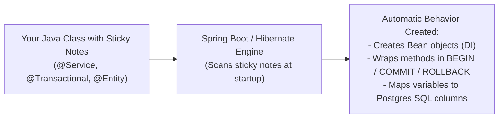
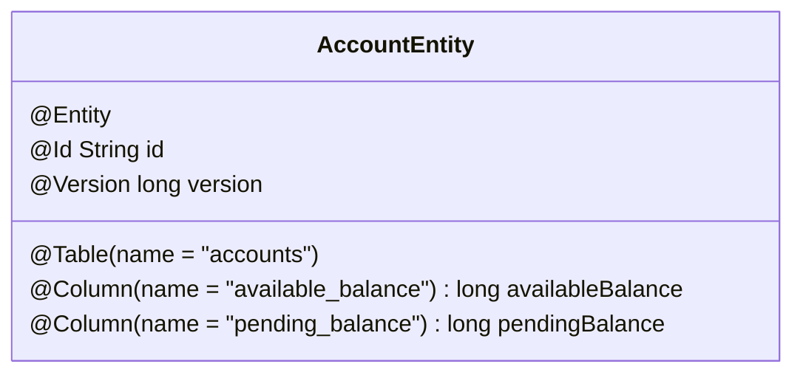

# Topic 13: Every Java & Spring Boot Annotation (`@...`) Used in Settle — Explained with Examples

---

## 1. First: What IS an Annotation (`@...`) in Java?

In Java, any word starting with **`@`** (like `@Service`, `@Entity`, `@Transactional`) is called an **Annotation**.
* **Think of an Annotation as a Sticky Note / Label** that you stick onto a class, method, or variable.
* By itself, a sticky note doesn't do anything—**until Spring Boot or Hibernate reads that sticky note at startup** and automatically generates code or runs special behavior for you!



---

## 2. Group A: Spring Boot Startup & Dependency Injection (Bean) Annotations

These annotations tell Spring Boot: **"Create an object (Bean) of this class at startup and manage it in the IoC container."**

### 1. `@SpringBootApplication`
* **Where we used it:** [`AccountServiceApplication.java`](../services/account-service/src/main/java/dev/settle/account/AccountServiceApplication.java)
* **Plain-English Meaning:** The master power switch on your `main` class. It combines 3 annotations in one:
  1. `@Configuration`: Allows registering extra beans.
  2. `@EnableAutoConfiguration`: Inspects your `pom.xml` jars (sees Postgres, Flyway, Hibernate) and automatically sets up the database connection pool and Flyway runner.
  3. `@ComponentScan`: Scans all folders inside `dev.settle.account.*` looking for `@Component`, `@Service`, and `@Repository`.
* **Code Example:**
  ```java
  @SpringBootApplication
  public class AccountServiceApplication {
      public static void main(String[] args) {
          SpringApplication.run(AccountServiceApplication.class, args);
      }
  }
  ```
* **What breaks if you remove it?** Spring doesn't scan your folders or connect to Postgres—the app starts and immediately exits doing nothing!

---

### 2. `@Component`
* **Where we used it:** [`AccountGrpcController.java`](../services/account-service/src/main/java/dev/settle/account/controller/AccountGrpcController.java), [`AccountDaoImpl.java`](../services/account-service/src/main/java/dev/settle/account/dao/impl/AccountDaoImpl.java), [`GrpcServerConfig.java`](../services/account-service/src/main/java/dev/settle/account/config/GrpcServerConfig.java)
* **Plain-English Meaning:** The general-purpose sticky note that tells Spring: *"Create 1 singleton object of this class at startup and keep it ready to inject into other classes."*
* **Code Example:**
  ```java
  @Component
  public class AccountDaoImpl implements AccountDao { ... }
  ```
* **What breaks if you remove it?** Spring won't create `AccountDaoImpl`, so `AccountServiceImpl` crashes at startup with: `NoSuchBeanDefinitionException: No qualifying bean of type 'AccountDao' available`.

---

### 3. `@Service`
* **Where we used it:** [`AccountServiceImpl.java`](../services/account-service/src/main/java/dev/settle/account/service/impl/AccountServiceImpl.java)
* **Plain-English Meaning:** Works identically to `@Component`, but specifically labels the class as the **Business Logic / Service Layer** (The Head Chef).
* **Code Example:**
  ```java
  @Service
  public class AccountServiceImpl implements AccountService { ... }
  ```
* **What breaks if you remove it?** Spring won't create `AccountServiceImpl`, so `AccountGrpcController` fails to start!

---

### 4. `@Repository`
* **Where we used it:** [`AccountRepository.java`](../services/account-service/src/main/java/dev/settle/account/repository/AccountRepository.java), [`HoldRepository.java`](../services/account-service/src/main/java/dev/settle/account/repository/HoldRepository.java), etc.
* **Plain-English Meaning:** Labels a database repository interface. Besides registering it as a Spring bean, it also **translates low-level SQL/JDBC errors into clean Spring `DataAccessException`s**.
* **Code Example:**
  ```java
  @Repository
  public interface AccountRepository extends JpaRepository<AccountEntity, String> { ... }
  ```

---

### 5. `@Value("${...}")`
* **Where we used it:** [`GrpcServerConfig.java`](../services/account-service/src/main/java/dev/settle/account/config/GrpcServerConfig.java)
* **Plain-English Meaning:** Reads a configuration value from [`application.yml`](../services/account-service/src/main/resources/application.yml) (or an environment variable) and passes it into a variable or constructor parameter.
* **Code Example:**
  ```java
  // Reads settle.grpc.port from application.yml (defaults to 9090 if missing)
  public GrpcServerConfig(
          AccountGrpcController accountGrpcController,
          @Value("${settle.grpc.port:9090}") int port) {
  ```

---

## 3. Group B: Database Transaction Annotation

### 6. `@Transactional`
* **Where we used it:** [`AccountServiceImpl.java`](../services/account-service/src/main/java/dev/settle/account/service/impl/AccountServiceImpl.java) (on `createHold`, `completeHold`, `cancelHold`)
* **Plain-English Meaning:** Wraps the entire method in an **All-or-Nothing Postgres Transaction**:
  * Before line 1 runs → sends **`BEGIN`** to Postgres.
  * When `return` finishes → sends **`COMMIT`** to Postgres (saving all changes atomically and releasing all `FOR UPDATE` row locks).
  * If any runtime exception is thrown → sends **`ROLLBACK`** to Postgres (undoing every partial change made in that method!).
* **Code Example:**
  ```java
  @Override
  @Transactional
  public CompleteHoldResponseDto completeHold(CompleteHoldRequestDto request) { ... }
  ```
* **What breaks if you remove it?**
  1. If the app crashes halfway through `completeHold` (after deducting ₹500 from Sayantan, before crediting Rahul), Sayantan loses ₹500 permanently!
  2. Calling `@Lock(LockModeType.PESSIMISTIC_WRITE)` throws `TransactionRequiredException: no transaction is in progress`!

---

## 4. Group C: JPA / Hibernate Database Table Mapping Annotations (`entity/`)

These annotations link a Java class in `entity/` to a SQL table in [`V1__init_ledger.sql`](../services/account-service/src/main/resources/db/migration/V1__init_ledger.sql).



### 7. `@Entity` & 8. `@Table(name = "...")`
* **Where we used them:** [`AccountEntity.java`](../services/account-service/src/main/java/dev/settle/account/entity/AccountEntity.java), [`HoldEntity.java`](../services/account-service/src/main/java/dev/settle/account/entity/HoldEntity.java), [`LedgerEntryEntity.java`](../services/account-service/src/main/java/dev/settle/account/entity/LedgerEntryEntity.java), [`IdempotencyRecordEntity.java`](../services/account-service/src/main/java/dev/settle/account/entity/IdempotencyRecordEntity.java)
* **Plain-English Meaning:**
  * `@Entity`: Tells Hibernate *"1 object of this class = 1 row in a database table."*
  * `@Table(name = "accounts")`: Tells Hibernate which exact SQL table name in Postgres this class maps to.
* **Code Example:**
  ```java
  @Entity
  @Table(name = "accounts")
  public class AccountEntity { ... }
  ```

---

### 9. `@Id` & 10. `@GeneratedValue(strategy = GenerationType.IDENTITY)`
* **Where we used them:** `@Id` in all 4 entities; `@GeneratedValue` in [`LedgerEntryEntity.java`](../services/account-service/src/main/java/dev/settle/account/entity/LedgerEntryEntity.java)
* **Plain-English Meaning:**
  * `@Id`: Marks the `PRIMARY KEY` column of the table.
  * `@GeneratedValue(strategy = GenerationType.IDENTITY)`: Tells Hibernate *"Do not invent an ID in Java—let Postgres's `BIGSERIAL` auto-increment (`1, 2, 3...`) generate the ID on `INSERT`!"*
* **Code Example:**
  ```java
  @Id
  @GeneratedValue(strategy = GenerationType.IDENTITY)
  @Column(name = "id")
  private Long id;
  ```

---

### 11. `@Column(name = "...", nullable = false, updatable = false)`
* **Where we used it:** On every field in our 4 entity classes.
* **Plain-English Meaning:** Maps a Java camelCase field (`availableBalance`) to a SQL snake_case column (`available_balance`).
  * `updatable = false` (used on `LedgerEntryEntity` and `createdAt`): Guarantees Hibernate will **never** include this column in an `UPDATE` statement (enforcing an append-only passbook!).
* **Code Example:**
  ```java
  @Column(name = "available_balance", nullable = false)
  private long availableBalance;
  ```

---

### 12. `@Enumerated(EnumType.STRING)`
* **Where we used it:** [`HoldEntity.java`](../services/account-service/src/main/java/dev/settle/account/entity/HoldEntity.java) (`HoldStatus`), [`LedgerEntryEntity.java`](../services/account-service/src/main/java/dev/settle/account/entity/LedgerEntryEntity.java) (`EntryType`)
* **Plain-English Meaning:** Tells Hibernate to store the enum's **text name** (`"PENDING"`, `"COMPLETED"`, `"DEBIT"`) in Postgres instead of its fragile array index number (`0`, `1`, `2`).
* **Code Example:**
  ```java
  @Enumerated(EnumType.STRING)
  @Column(name = "status", nullable = false, length = 20)
  private HoldStatus status;
  ```
* **What breaks if you remove it?** Hibernate defaults to `EnumType.ORDINAL` and tries to insert integer `0` into your `VARCHAR` column, failing your SQL `CHECK (status IN ('PENDING', 'COMPLETED', 'CANCELLED'))` constraint!

---

### 13. `@Version`
* **Where we used it:** [`AccountEntity.java`](../services/account-service/src/main/java/dev/settle/account/entity/AccountEntity.java)
* **Plain-English Meaning:** Enables **Optimistic Locking**. Every time an `AccountEntity` is updated, Hibernate automatically checks `WHERE version = old_version` and increments `version = version + 1`.
* **Code Example:**
  ```java
  @Version
  @Column(name = "version", nullable = false)
  private long version;
  ```

---

## 5. Group D: Spring Data JPA Query & Locking Annotations (`repository/`)

### 14. `@Lock(LockModeType.PESSIMISTIC_WRITE)`
* **Where we used it:** [`AccountRepository.java`](../services/account-service/src/main/java/dev/settle/account/repository/AccountRepository.java), [`HoldRepository.java`](../services/account-service/src/main/java/dev/settle/account/repository/HoldRepository.java)
* **Plain-English Meaning:** Appends **`FOR UPDATE`** to the `SELECT` query so Postgres places an exclusive row lock on the account/hold until the `@Transactional` method commits.

### 15. `@Query("...")` & 16. `@Param("...")`
* **Where we used them:** [`AccountRepository.java`](../services/account-service/src/main/java/dev/settle/account/repository/AccountRepository.java)
* **Plain-English Meaning:**
  * `@Query`: Defines the exact JPQL query to execute (`SELECT a FROM AccountEntity a WHERE a.id = :id`).
  * `@Param("id")`: Binds the Java method parameter `String id` to the `:id` placeholder inside `@Query`.
* **Code Example:**
  ```java
  @Lock(LockModeType.PESSIMISTIC_WRITE)
  @Query("SELECT a FROM AccountEntity a WHERE a.id = :id")
  Optional<AccountEntity> findByIdForUpdate(@Param("id") String id);
  ```

---

## 6. Group E: Testing & Testcontainers Annotations (`src/test/java`)

| Annotation | Where Used | Plain-English Meaning |
|---|---|---|
| **`@SpringBootTest`** | `AccountServiceIntegrationTest` | Boots the full Spring Boot application context (beans, Flyway, repositories, services) for an integration test. |
| **`@Testcontainers`** | `AccountServiceIntegrationTest` | Tells JUnit 5 to automatically start and stop any Docker `@Container` fields in the test class. |
| **`@Container`** | `static PostgreSQLContainer<?> postgres` | Marks the Docker container (`postgres:18-alpine`) to be managed by Testcontainers. |
| **`@ServiceConnection`** | `static PostgreSQLContainer<?> postgres` | Automatically wires the temporary Docker Postgres container's dynamic port, username, and password into Spring Boot's `DataSource`! |
| **`@Autowired`** | Test fields (`accountService`, etc.) | Asks Spring to inject the real bean into the test class field before tests run. |
| **`@BeforeEach`** | `void setUp()` | Runs before **every** `@Test` method to wipe tables and seed fresh ₹1,000 test accounts (`acc_A` and `acc_B`). |
| **`@Test`** | Each test method | Marks a method as a runnable JUnit test case executed by `mvn test`. |
| **`@Override`** | Interface methods | Compiler safety check proving a method overrides a method from a parent class or interface. |
