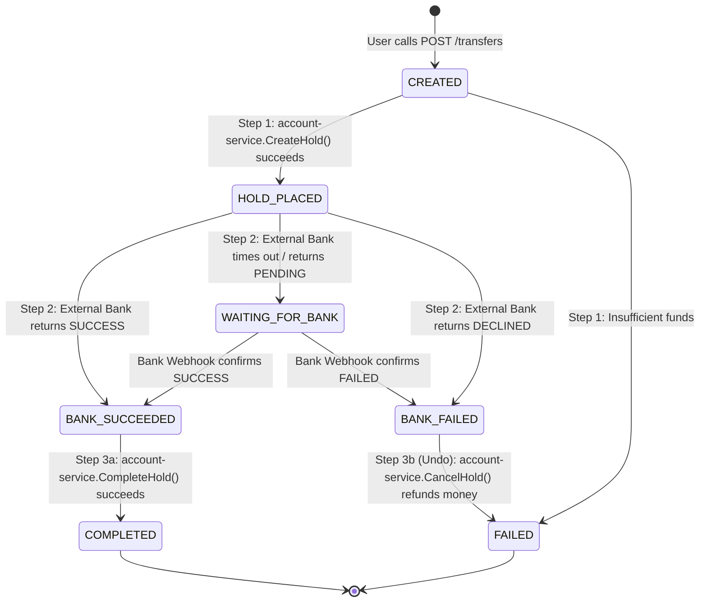
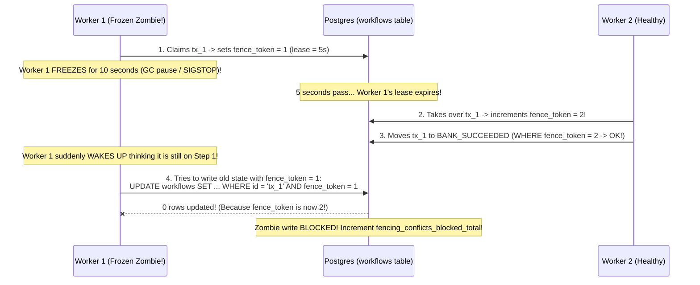

# Topic 14: The Durable Saga Engine (`payment-orchestrator`), 2PC vs Sagas, Leases & Fencing Tokens

---

## 1. Why Do We Need a Saga Engine? (Why `@Transactional` Isn't Enough Here)

Inside `account-service` (Phase 1), `@Transactional` worked because all 4 tables (`accounts`, `holds`, `ledger_entries`, `idempotency_records`) lived inside **one single Postgres database**.

Now in Phase 2, a transfer has to cross **different servers over the network**:
1. **`account-service` (Java + Postgres `accounts` DB):** Freeze ₹500 (`CreateHold`).
2. **`rail-stub` (External Partner Bank over HTTP):** Pay out ₹500 to the external bank.
3. **`account-service` (Java + Postgres `accounts` DB):** If bank succeeded → `CompleteHold`; if bank failed → `CancelHold`.

**You cannot put `@Transactional` across `account-service` and an external bank API!**
If the server crashes right after Step 1 (₹500 is frozen in `PENDING`), who remembers to call Step 2 and Step 3 when the server restarts?
**Answer: The Durable Saga Engine (`payment-orchestrator`)!**

---

## 2. Visual Picture: The Transfer Checklist State Machine

Think of `payment-orchestrator` as a **Checklist Manager** that saves its current step in the `workflows` table after every single action:



### Look at How Every State Tells the Worker Exactly What to Do Next:

| Current `state` in `workflows` Table | What Already Happened | What the Go Worker Must Do Next |
|---|---|---|
| **`CREATED`** | User requested transfer of ₹500 | Call `account-service.CreateHold()` → save `hold_id` → move to **`HOLD_PLACED`** |
| **`HOLD_PLACED`** | ₹500 is frozen in `pending_balance` (`hold_1`) | Call External Bank (`POST /payouts`) |
| **`WAITING_FOR_BANK`** | External bank timed out or returned `PENDING` | **Do nothing & wait** for the bank's webhook (never unfreeze on a timeout!) |
| **`BANK_SUCCEEDED`** | External bank confirmed ₹500 payout succeeded | Call `account-service.CompleteHold(hold_1)` → move to **`COMPLETED`** |
| **`BANK_FAILED`** | External bank confirmed payout failed | Call `account-service.CancelHold(hold_1)` (Refund!) → move to **`FAILED`** |
| **`COMPLETED`** / **`FAILED`** | Transfer is 100% done | Terminal state (nothing left to do) |

---

## 3. How `payment-orchestrator` Recovers From Server Crashes (`kill -9`) and Stops "Zombie Workers"

Suppose we run **3 Go Worker processes** (`Worker 1`, `Worker 2`, `Worker 3`) polling the `workflows` table for work:

### A. Claiming Work Without Colliding (`FOR UPDATE SKIP LOCKED`)
When 3 workers query Postgres for due workflows at the same time:
```sql
SELECT * FROM workflows
WHERE state IN ('CREATED', 'HOLD_PLACED', 'BANK_SUCCEEDED', 'BANK_FAILED')
  AND (lease_until IS NULL OR lease_until < NOW())
  AND next_run_at <= NOW()
ORDER BY next_run_at ASC
LIMIT 1
FOR UPDATE SKIP LOCKED;
```
* **`FOR UPDATE`:** Locks the workflow row being claimed.
* **`SKIP LOCKED`:** If `Worker 1` is currently locking Transfer #1, `Worker 2` doesn't block waiting for Transfer #1—it immediately **skips** Transfer #1 and grabs Transfer #2!

---

### B. Worker Leases (`lease_owner` & `lease_until`) — Surviving `kill -9` Crashes
When `Worker 1` grabs Transfer #1, it sets a **5-second lease** in Postgres:
* `lease_owner = 'worker_1'`
* `lease_until = NOW() + 5 seconds`

What if someone pulls the power plug on `Worker 1` (`kill -9`) while it is in state `HOLD_PLACED`?
1. `Worker 1` dies immediately.
2. 5 seconds later, `lease_until < NOW()` becomes **true**!
3. `Worker 2` runs the poll query above, sees Transfer #1's lease has expired, takes over Transfer #1 (`lease_owner = 'worker_2'`), sees its state is `HOLD_PLACED`, and finishes the transfer!

---

### C. Fencing Tokens (`fence_token`) — Stopping the "Zombie Worker" Bug!
What if `Worker 1` didn't die—what if `Worker 1` just **froze for 10 seconds** (e.g., an OS pause, debugger pause, or `SIGSTOP`), and then woke back up?



* Every time a worker claims a workflow lease, Postgres increments **`fence_token = fence_token + 1`** (`1 -> 2 -> 3`).
* Every time a worker updates the workflow state, it **must** pass its `fence_token` in the `WHERE` clause:
  ```sql
  UPDATE workflows
  SET state = $1, fence_token = $2, ...
  WHERE id = $3 AND fence_token = $2;
  ```
* If `Worker 1` (holding old `fence_token = 1`) wakes up after `Worker 2` took over (`fence_token = 2`), `WHERE fence_token = 1` matches **0 rows**! The zombie worker realizes it lost its lease, increments our defense metric **`fencing_conflicts_blocked_total`**, and stops immediately!

---

## 4. Interview Questions & How to Answer Them

### Q1: Why use a Saga instead of Two-Phase Commit (2PC / XA Transactions) across microservices?
* **Winning Answer:**
  "Two-Phase Commit (2PC) requires every participant to hold database row locks open across network round-trips while waiting for the coordinator's prepare and commit phases. If any service or third-party bank rail is slow or crashes during 2PC, locks stay held and bring throughput to a halt—and external partner banks don't support XA/2PC anyway. A **Saga** breaks the workflow into local ACID transactions (`CreateHold`, external bank call, `CompleteHold`), releasing database locks immediately after each step and using **compensating actions** (`CancelHold`) to undo prior steps if a later step fails."

### Q2: Why isn't a time-based Lease (or Redis TTL lock) alone enough for distributed safety? Why do you need a Fencing Token?
* **Winning Answer:**
  "As Martin Kleppmann showed, a client holding a time-based lease can experience an arbitrarily long pause (GC pause, OS scheduling delay, or network delay) *after* checking that its lease is valid but *before* its write reaches the database. During that pause, the lease expires and a second worker acquires the lease. When the first ('zombie') worker wakes up, it overwrites the second worker's newer state. A monotonically increasing **fencing token** (`fence_token = fence_token + 1` on every lease acquisition, verified via `WHERE fence_token = :my_token` on every write) guarantees the storage layer itself rejects any stale write from an expired lease holder."
