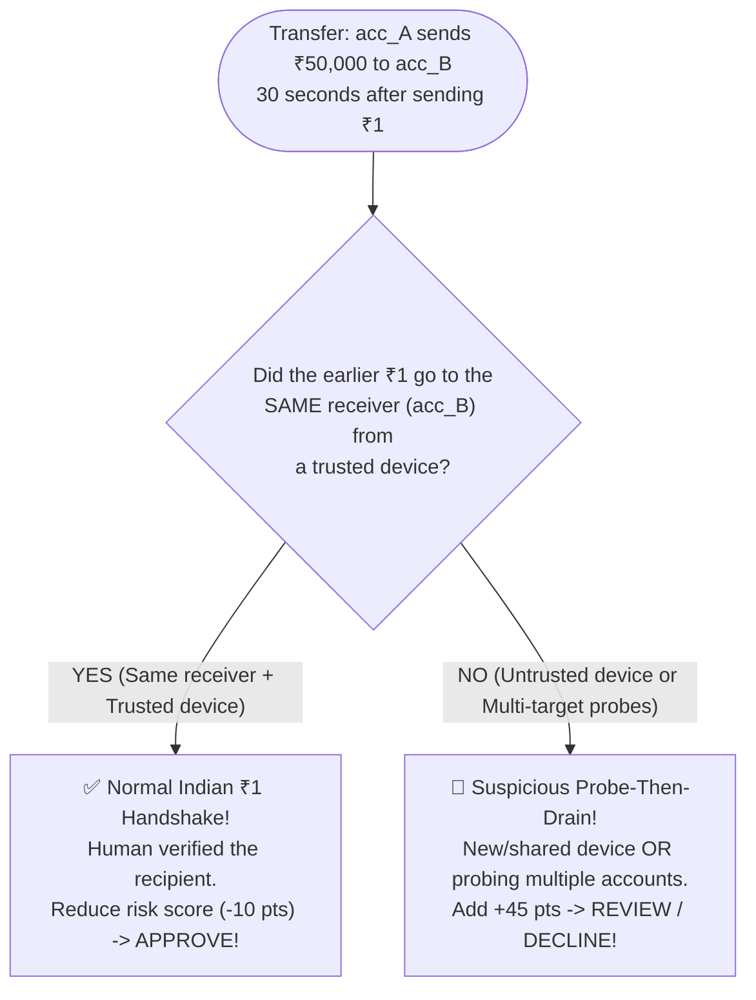

# Topic 15: Real-World Fraud Detection — Why Fixed Amount Limits & Naive ₹1 Rules Fail (False Positives)

> **Update (2026-11-24):** the design was revised in [docs/FRAUD_ENGINE_RND.md](../docs/FRAUD_ENGINE_RND.md) (v2). Two changes affect this note: the ₹1 handshake is now **neutral (0 pts)** instead of −10, because scam victims do the handshake from their own phone too; and the score is **capped at 100**. The baseline uses p90 of recent amounts instead of the average.

---

## 1. Your Real-World Insight (Why Naive Fraud Rules Fail in India / UPI)
> *"In real life, transferring more than ₹50k or ₹100k is completely normal for many people—so how do we detect if a high amount is actually fraud? And when paying a new person, almost everyone in India first sends ₹1 to verify and then sends the full amount—that is normal human behavior, not fraud!"*

This exact observation is the **#1 difference between a toy rules engine and a real fintech fraud engine (like Stripe Radar, Razorpay, or PhonePe)**.

---

## 2. Problem 1: Why Fixed Amount Cutoffs (`amount > ₹50,000`) Fail

If you write a naive rule `if (amount > 50_000) -> REVIEW/DECLINE`:
* **False Positive (Angry Good Customer):** A business owner who pays suppliers ₹80,000 every week gets blocked on every single transfer.
* **False Negative (Missed Fraud):** A college student who only spends ₹150 on coffee has their account hacked, and the hacker steals ₹15,000 (which passes under the ₹50,000 limit!).

### The Real Solution: Personal Behavioral Baseline (`amount / user_avg_amount`) + Device Trust
Instead of asking *"Is `amount > ₹50,000`?"*, we ask:
1. **"How many times larger is this transfer than THIS user's personal average (`z-score` / multiplier)?"**
   * Business owner (average `₹60,000`) sends `₹1,00,000` → Only **`1.6x`** their normal average → **`0 risk points` (`APPROVE`)!**
   * College student (average `₹200`) suddenly sends `₹30,000` → **`150x`** their normal average → **`+35 risk points` (`PERSONAL_BASELINE_SPIKE`)!**
2. **"Is this coming from the user's trusted `device_id`, or a brand-new `device_id`?"**
   * Even if the college student pays ₹30,000 for college tuition from their **own usual phone** (`trusted_device`), `+35 points` is `< 40`, so it still **`APPROVE`s**!
   * If that `150x` spike comes from a **brand-new `device_id`** (`NEW_DEVICE_ANOMALY` `+30 points`), now `35 + 30 = 65 points` → **Pauses for `REVIEW` (`40–79`)**!

---

## 3. Problem 2: The "Indian ₹1 Handshake" vs "Bot Card-Testing / Probing"

In India, when paying a new recipient (`acc_B`) for the first time:
* **Normal Human Behavior ("The ₹1 Handshake"):**
  1. Sends `₹1` from `acc_A` → **`acc_B`** on their trusted phone.
  2. Asks *"Did you get ₹1?"*
  3. Sends `₹50,000` from `acc_A` → **the exact same `acc_B`** on the same phone!
* **Actual Fraudster / Bot Behavior:**
  * A bot testing stolen accounts fires rapid transfers to **multiple different accounts (`acc_B`, `acc_C`, `acc_D`)**, OR fires from a **brand-new unrecognized device / shared attacker device**!

---

## 4. Our Refined 4-Branch Scoring Engine for `risk-service`

| Signal Branch | When It Fires (Context-Aware!) | Points Added | Why It Avoids False Positives |
|---|---|---|---|
| **1. Personal Baseline Spike (`PERSONAL_AMOUNT_SPIKE`)** | Transfer is **`>= 10x`** this user's historical average transfer amount (and `> ₹10,000`). | **`+35 pts`** | A user who regularly sends ₹50k–₹100k gets `0 pts` on a ₹100k transfer! |
| **2. Account Takeover (`UNTRUSTED_DEVICE_HIGH_VALUE`)** | Sender is using a **new/unrecognized `device_id`** AND sending to a new recipient. *(If the user did a ₹1 handshake to the SAME receiver from a trusted device, risk is reduced by `-10 pts`!)*. | **`+30 pts`** | Alone (`30 pts`), a new phone buying something small is approved. Combined with a `10x` amount spike (`35 + 30 = 65 pts`), it pauses for **`REVIEW`**! |
| **3. Bot Burst Velocity (`RAPID_BURST_VELOCITY`)** | Sender fires **`>= 5` transfers within 60 seconds** across accounts (normal ₹1 handshake + 1 main payment is only 2 transfers!). | **`+40 pts`** | Allows the 2-step "₹1 test + main payment" without ever triggering! |
| **4. Network Contagion Ring (`SHARED_DEVICE_RING` / `MULE_FAN_IN`)** | • Same `device_id` used by **`>= 3` different sender accounts** in 10 mins (`+50 pts`) • Same receiver gets money from **`>= 4` different senders** in 5 mins (`+45 pts`) | **`+45 to +50 pts`** | Catches hacker devices and money-mule accounts across the network! |

### How the Score Maps to `APPROVE`, `REVIEW`, and `DECLINE`:
* **`0 – 39 points` → `APPROVE`** *(Single mild signal, or normal high-value user, or trusted ₹1 handshake + payment)*
* **`40 – 79 points` → `REVIEW`** *(Two suspicious signals combine, e.g. `10x Personal Spike (35) + New Device (30) = 65` → Pauses transfer for AI + Human review!)*
* **`80 – 100 points` → `DECLINE`** *(Three signals or confirmed attack ring, e.g. `Shared Hacker Device (50) + Personal Spike (35) = 85` → Instant block!)*

---

## 5. Interview Questions & How to Answer Them

### Q1: In a payment fraud system, why can't you just block transactions above ₹50,000 or block a small ₹1 transfer followed by a large transfer?
* **Winning Answer:**
  "Static rules without user and cultural context create massive false-positive rates:
  1. **Relative vs Absolute Amounts:** ₹1,00,000 is normal for a business account whose mean transaction is ₹60,000, whereas ₹15,000 is anomalous for an account whose mean transaction is ₹200. Instead of static cutoffs, we score the ratio of the transaction amount against the account's historical baseline (`amount / user_avg_amount`).
  2. **Cultural Payment Patterns (The UPI ₹1 Handshake):** In India, users routinely send ₹1 to a new beneficiary to verify arrival before sending ₹50,000 to that same beneficiary. A naive card-testing rule would block legitimate users. We distinguish legitimate handshakes from bot probing by checking whether the ₹1 and follow-up transfer target the **same beneficiary from a trusted device** (2 transfers total) versus automated multi-beneficiary probing or untrusted devices."

---

## 6. Design Review (2026-11-24): "Can we make the fraud engine better?"

> *Your question:* "Check my fraud engine doc and suggest how to make it better, using real-world research."

The full fixed design is in [docs/FRAUD_ENGINE_RND.md](../docs/FRAUD_ENGINE_RND.md). These are the five lessons worth remembering.

### Lesson 1: Cosine similarity only sees direction, not size
Cosine compares the *angle* between two vectors. If one feature is much bigger than the others (an amount ratio of 150 next to counts of 1), it decides the angle almost alone:

| Vector A | Vector B | Cosine |
|---|---|---|
| Fraud: 150x spike from a **new** phone `[150,1,1,1,1,1]` | Student: 150x tuition from **own** phone `[150,1,1,0,1,1]` | **0.99998** |
| `[2,6,6,1,4,1]` | the same ×10 | **1.0** |

**Fix:** squash big numbers with `log1p`, standardise every feature (`(x - mean) / std`), then compare with **L2 distance**, which sees both direction and size.

### Lesson 2: Retries must not change the answer
The orchestrator retries `CheckRisk` with the same `transfer_id`. If every call adds to the velocity counters, a network retry looks like a bot burst. **Fix:** store one decision row per `transfer_id` (a retry returns it), and count with Redis sorted sets whose member is the `transfer_id` (`ZADD` of the same member adds nothing). This is the same idea as idempotency keys in the ledger.

### Lesson 3: Fixed windows and TTL keys aren't real sliding windows
`INCR` + `EXPIRE` resets the count at the window edge, so 2x the limit can pass across a boundary. **Fix:** sorted set with timestamps; in one Lua script: `ZREMRANGEBYSCORE` (drop old) → `ZADD` → `ZCARD` → `PEXPIRE`.

### Lesson 4: A learning loop can be poisoned
- One fraud confirmation instantly blocking every similar transfer = one wrong click blocks many good users.
- One approval instantly trusting a device = a fraudster who passes review once is trusted next time.

**Fix:** learn slowly. Patterns go CANDIDATE → SHADOW (log only) → ACTIVE, only after ≥ 3 confirmations, and they expire. A device is trusted only after several clean transfers over days.

### Lesson 5: In India, the victim often pays from their own phone
Most money lost to cyber fraud in India in 2025 went to fake investment schemes, where victims send the money themselves, often after a ₹1 test the scammer asked for. So "trusted device + ₹1 handshake → lower risk" helps the scammer. **Fix:** the handshake is neutral, and the receiver is scored instead: mule fan-in (many senders), pass-through (money in and straight out), new account, and a risky-beneficiary list (modelled on DoT's Financial Fraud Risk Indicator).

### Interview questions

**Q2: "Your fraud check is called again on retry. What happens?"**
"`CheckRisk` is idempotent on `transfer_id`. The first call stores the decision with its features and rules version; retries return that stored decision. Velocity windows are Redis sorted sets with the `transfer_id` as member, so a retry can't inflate the counts. Two concurrent first calls race on a unique key, and the loser returns the winner's row."

**Q3: "How would you stop authorised push-payment scams, where the real user sends the money?"**
"Device and login checks all pass, because it really is the user. So I score the receiver: how many different senders paid it in the last few minutes, whether money leaves it right after arriving, how new it is, and whether it's on a shared risk list. I'd also add friction for first large payments to a new payee, like a warning or a cooling-off delay."

**Q4: "How does your system learn from reviewer decisions safely?"**
"Learning never acts directly. A confirmed fraud creates a candidate pattern; it needs three confirmations and a week in shadow mode with no matches on legitimate transfers before it adds points, it can't decline on its own, and it expires. Approvals build device trust gradually rather than instantly."

**Q5: "Why not cosine similarity for matching fraud patterns?"**
"Cosine ignores magnitude, so on raw features the largest one dominates. A 150x spike from a trusted phone matched an account-takeover pattern at 0.99998. I log-scale and standardise the features and use L2 distance."
